# Search Intel

**The first WordPress plugin built for all three pillars of modern search visibility: SEO, AEO, and GEO.**

[](LICENSE.md)
[](https://wordpress.org/)
[](https://php.net/)

**[Roadmap](ROADMAP.md)** · **[Changelog](CHANGELOG.md)** · **[License](LICENSE.md)**

---

## Table of Contents

- [Overview](#overview)
- [Architecture](#architecture)
- [Module Breakdown](#module-breakdown)
- [Data Flow](#data-flow)
- [Admin Interface](#admin-interface)
- [Schema Output Pipeline](#schema-output-pipeline)
- [Scoring System](#scoring-system)
- [Installation](#installation)
- [Configuration](#configuration)
- [Shortcodes](#shortcodes)
- [Hooks and Filters](#hooks-and-filters)
- [File Structure](#file-structure)
- [Compatibility](#compatibility)
- [Security](#security)
- [Contributing](#contributing)
- [License](#license)

---

## Overview

Search Intel optimizes WordPress content across three dimensions:

| Pillar | Target | What It Optimizes For |
|--------|--------|----------------------|
| **SEO** | Google, Bing, traditional crawlers | Meta tags, Open Graph, Twitter Cards, sitemaps, schema |
| **AEO** | Featured snippets, voice assistants, PAA | FAQ/HowTo schema, Speakable, concise answer formatting |
| **GEO** | ChatGPT, Perplexity, Google AI Overviews | AI summaries, llms.txt, entity markup, E-E-A-T, freshness |

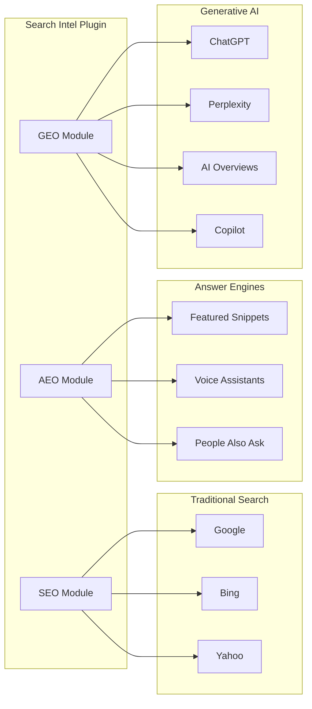

---

## Architecture

### High-Level Module Architecture

```mermaid
graph TD
    BOOT["search-intel.php<br/><i>Bootstrap & Autoloader</i>"]
    CORE["Core<br/><i>Singleton Orchestrator</i>"]
    
    BOOT --> CORE

    CORE --> TITLE["Title Engine"]
    CORE --> SEO["SEO Manager"]
    CORE --> SCHEMA["Schema Manager"]
    CORE --> AEO["AEO Manager"]
    CORE --> GEO["GEO Manager"]
    CORE --> ANALYZER["Content Analyzer"]
    CORE --> SITEMAP["Sitemap"]
    CORE --> ADMIN["Admin<br/><i>only in wp-admin</i>"]

    TITLE --> TVAR["Variable Resolver"]
    TITLE --> TCTX["Per-Context Templates"]

    SEO --> META["Meta Tags"]
    SEO --> OG["Open Graph"]
    SEO --> TW["Twitter Cards"]
    SEO --> CAN["Canonical URLs"]
    SEO --> ROB["Robots Meta"]

    SCHEMA --> JSONLD["JSON-LD @graph"]
    SCHEMA --> BREAD["BreadcrumbList"]
    SCHEMA --> SITE["WebSite + SearchAction"]
    SCHEMA --> KG["Knowledge Graph"]

    AEO --> FAQ["FAQPage Schema"]
    AEO --> HOWTO["HowTo Schema"]
    AEO --> SPEAK["Speakable"]
    AEO --> AUTODETECT["Auto-detect FAQs"]
    AEO --> DIRECTANS["Direct Answer Meta"]
    AEO --> QAPAT["Q&A Detection"]
    AEO --> SNIPPET["Snippet Scoring"]

    GEO --> AIMETA["AI Meta Tags"]
    GEO --> LLMS["llms.txt Endpoint"]
    GEO --> ENTITY["Entity Markup"]
    GEO --> EEAT["E-E-A-T Schema"]
    GEO --> FRESH["Freshness Signals"]
    GEO --> AIBOT["AI Crawl Directives"]
    GEO --> INTENT["Intent & Audience Meta"]
    GEO --> LOCAL["Local Relevance"]

    ADMIN --> SETTINGS["Settings Pages x6"]
    ADMIN --> METABOX["Post Metabox"]
    ADMIN --> COLUMNS["Admin Columns"]
    ADMIN --> USERFIELDS["User E-E-A-T Fields"]

    style CORE fill:#2563eb,color:#fff
    style SEO fill:#16a34a,color:#fff
    style AEO fill:#d97706,color:#fff
    style GEO fill:#9333ea,color:#fff
    style TITLE fill:#0d9488,color:#fff
    style ANALYZER fill:#0891b2,color:#fff
    style ADMIN fill:#dc2626,color:#fff
```

### Class Dependency Map

```mermaid
classDiagram
    class Core {
        -instance : Core
        +title_engine : Title_Engine
        +seo : SEO_Manager
        +schema : Schema_Manager
        +aeo : AEO_Manager
        +geo : GEO_Manager
        +analyzer : Content_Analyzer
        +sitemap : Sitemap
        +admin : Admin
        +get_instance() Core
        +get_settings() array
        +get_default_settings() array
    }

    class Title_Engine {
        -settings : array
        +resolve_title() string
        +resolve_variables(template, context) string
        +get_default_templates() array
    }

    class SEO_Manager {
        -settings : array
        +get_title(post_id) string
        +get_description(post_id) string
        +render_meta_tags() void
        +render_canonical() void
        +render_robots_meta() void
        +render_open_graph() void
        +render_twitter_card() void
    }

    class Schema_Manager {
        -settings : array
        +render_schema() void
        +get_singular_schema(post_id) array
        -get_knowledge_graph() array
        -get_website_schema() array
        -get_breadcrumbs_schema() array
    }

    class AEO_Manager {
        -settings : array
        +get_faq_schema(post_id) array
        +get_howto_schema(post_id) array
        +render_speakable() void
        +render_direct_answer_meta() void
        +detect_qa_patterns(content) array
        +get_snippet_score(content) array
        +auto_lead_summary(excerpt, post) string
        +get_aeo_score(post_id) array
        -auto_detect_faqs(post_id) array
    }

    class GEO_Manager {
        -settings : array
        +render_ai_meta() void
        +serve_llms_txt() void
        +enhance_content_entities(content) string
        +render_author_eeat() void
        +get_geo_score(post_id) array
        -auto_extract_topics(post_id) array
    }

    class Content_Analyzer {
        -settings : array
        +analyze(post_id, content, title, keyword, desc) array
        +get_readability_score(text) array
        +ajax_analyze() void
        +analyze_on_save(post_id, post) void
        -get_content_checks(post_id, content, text, word_count) array
        -count_syllables(text) int
    }

    class Sitemap {
        -settings : array
        +register_endpoints() void
        +serve_sitemap() void
        +ping_search_engines(post_id) void
        +invalidate_cache() void
        -generate_sitemap_index() string
        -generate_sitemap(type, page) string
    }

    class Admin {
        -settings : array
        -core : Core
        +register_menu() void
        +register_metaboxes() void
        +save_metabox_data(post_id) void
        +render_user_eeat_fields(user) void
    }

    Core --> Title_Engine
    Core --> SEO_Manager
    Core --> Schema_Manager
    Core --> AEO_Manager
    Core --> GEO_Manager
    Core --> Content_Analyzer
    Core --> Sitemap
    Core --> Admin
    Admin --> Core
```

---

## Data Flow

### Frontend Output Pipeline

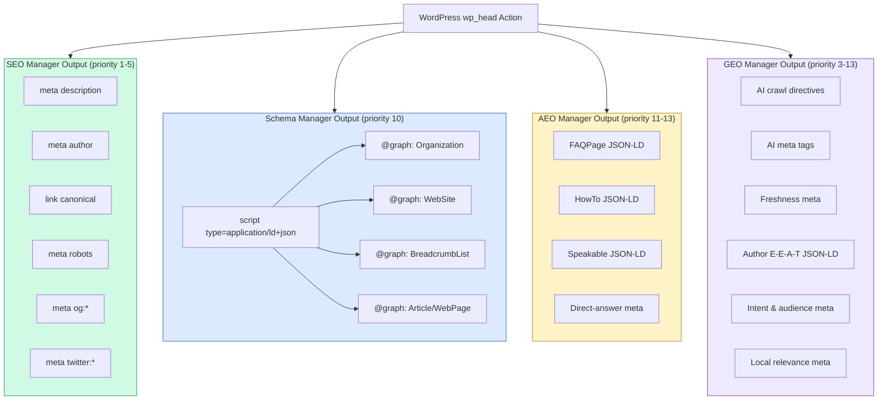

### Post Editor Metabox Data Flow

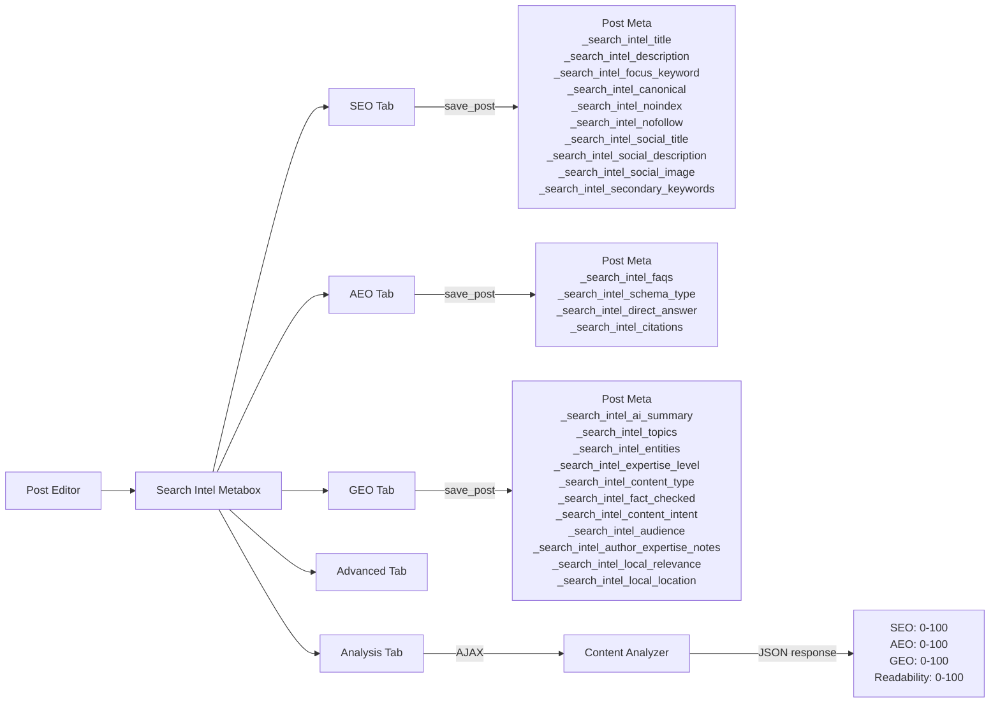

### Sitemap Request Flow

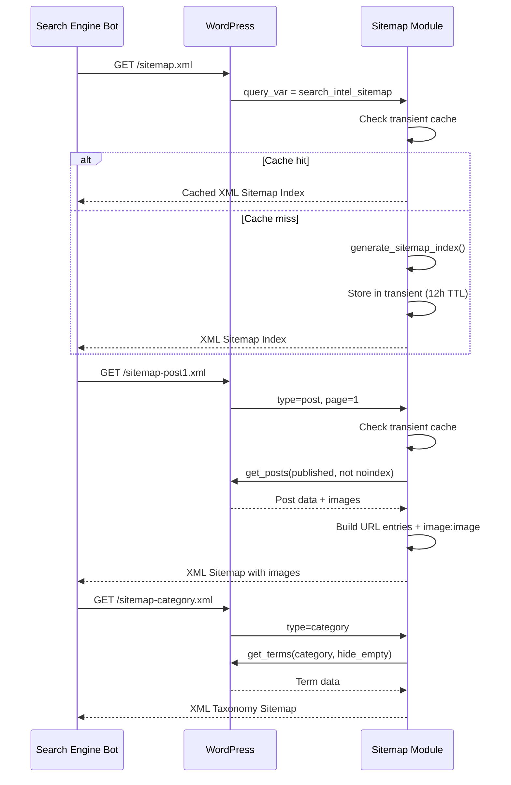

### llms.txt Request Flow

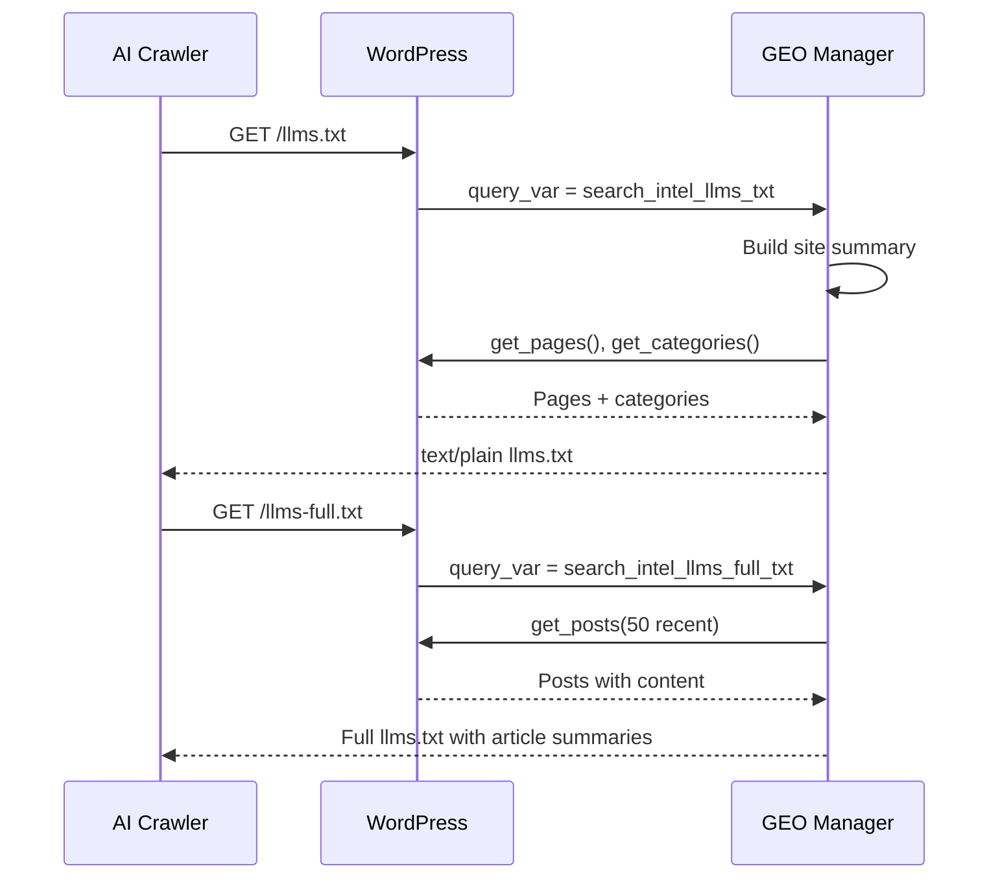

---

## Admin Interface

### Settings Page Structure

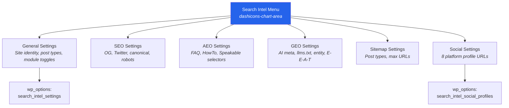

---

## Schema Output Pipeline

### JSON-LD Graph Assembly

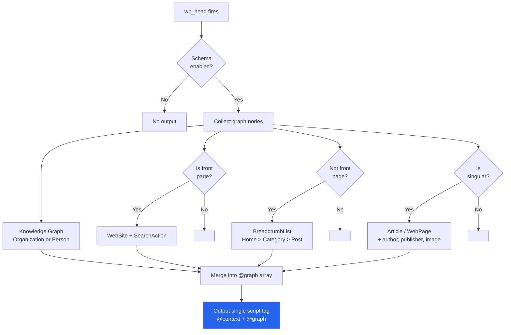

---

## Scoring System

### SEO Score Breakdown (100 points)

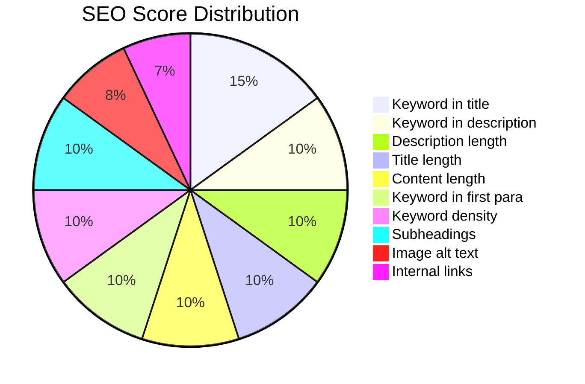

### AEO Score Breakdown (100 points)

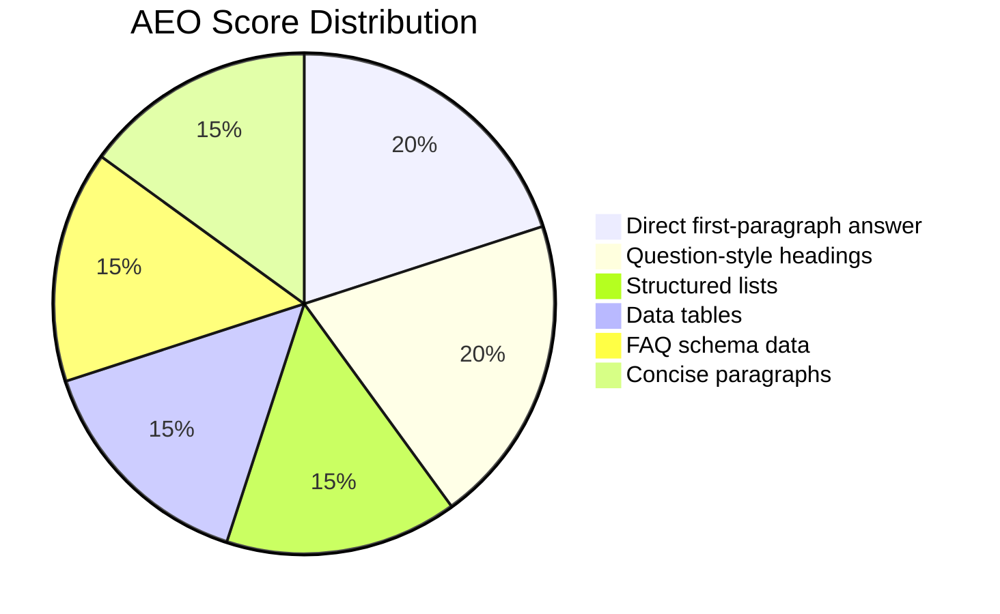

### GEO Score Breakdown (100 points)

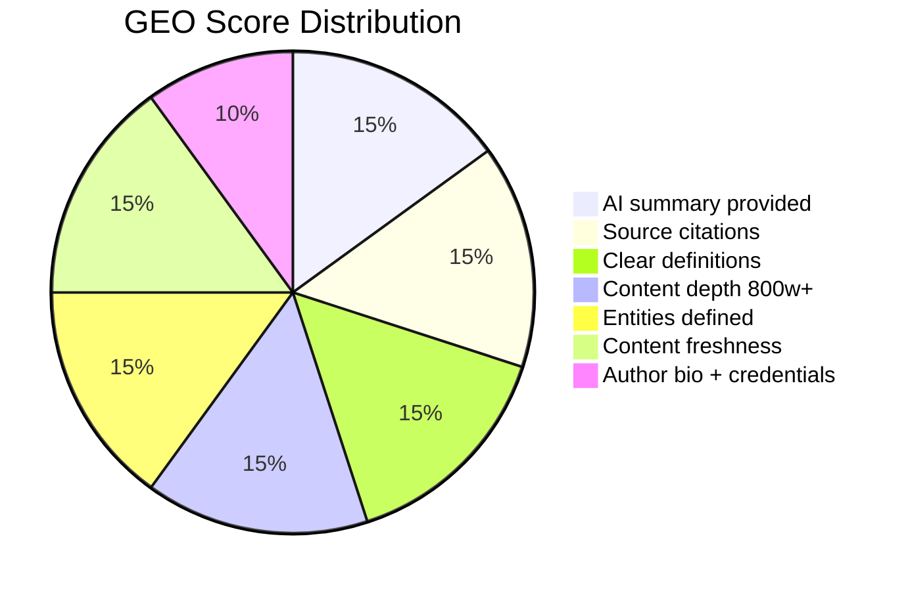

### Score Rating Thresholds

| Score Range | Rating | Color | Meaning |
|-------------|--------|-------|---------|
| 70 - 100 | Good | Green | Well optimized |
| 40 - 69 | Needs Work | Amber | Key improvements needed |
| 0 - 39 | Poor | Red | Significant optimization required |

---

## Installation

### Requirements

| Requirement | Minimum | Recommended |
|-------------|---------|-------------|
| WordPress | 6.0 | 6.5+ |
| PHP | 7.4 | 8.1+ |
| MySQL | 5.7 | 8.0+ |

### Steps

1. Download or clone this repository
2. Copy the `search-intel` folder to `wp-content/plugins/`
3. Activate via **Plugins > Installed Plugins**
4. Navigate to **Search Intel > General** to configure
5. Flush permalinks: **Settings > Permalinks > Save** (required for sitemap and llms.txt)

### Important

> **Deactivate other SEO plugins** (Yoast, Rank Math, All in One SEO, etc.) before activating Search Intel to avoid duplicate meta tags and schema conflicts.

---

## Configuration

### Quick Start

1. **General** — Set your site name, entity type (Organization/Person), and logo
2. **SEO** — Enable Open Graph, Twitter Cards, and robots settings
3. **AEO** — Enable FAQ/HowTo schema and Speakable
4. **GEO** — Enable AI meta, llms.txt, and entity markup
5. **Social** — Add your social profile URLs
6. **Sitemap** — Choose which post types to include

### Per-Post Settings

Every post and page gets a **Search Intel** metabox with five tabs:

| Tab | Fields |
|-----|--------|
| **SEO** | Title, description, focus keyword, canonical URL, noindex/nofollow, SERP preview, social title/description/image, secondary keywords |
| **AEO** | FAQ items (repeater), schema type override, direct-answer field, citation/source references repeater |
| **GEO** | AI summary, topics, expertise level, content type, fact-check date, entities, content intent, audience, author expertise notes, local relevance toggle + location |
| **Advanced** | AI crawler blocking |
| **Analysis** | Live SEO/AEO/GEO/Readability scores with actionable checks + 11 content quality checks |

---

## Shortcodes

### FAQ Block

```
[search_intel_faq question="What is SEO?" answer="SEO stands for Search Engine Optimization."]
```

### HowTo Block

```
[search_intel_howto name="How to Install a Plugin" time="PT5M"]
  Step content here...
[/search_intel_howto]
```

---

## Hooks and Filters

### Filters

| Filter | Description | Parameters |
|--------|-------------|------------|
| `search_intel_singular_schema` | Modify article/page schema before output | `$schema`, `$post_id` |

### Actions

All output hooks fire on `wp_head` with the following priorities:

| Priority | Module | Output |
|----------|--------|--------|
| 1 | SEO Manager | Meta description, author |
| 2 | SEO Manager | Canonical URL |
| 3 | SEO Manager / GEO | Robots meta, AI crawl directives |
| 4 | SEO Manager | Open Graph tags (with social overrides) |
| 5 | SEO Manager | Twitter Card tags (with social overrides) |
| 6 | GEO Manager | AI meta tags + intent, audience, expertise, local relevance |
| 7 | GEO Manager | Freshness meta |
| 10 | Schema Manager | JSON-LD @graph (with citations, audience, contentLocation) |
| 11 | AEO Manager | FAQ / HowTo schema |
| 12 | AEO Manager | Speakable schema |
| 13 | AEO Manager | Direct-answer meta tag |
| 13 | GEO Manager | Author E-E-A-T schema |
| 20 | SEO Manager | Document title filter |
| 25 | Title Engine | Template-based title resolution |

---

## File Structure

```
search-intel/
├── search-intel.php              # Main plugin bootstrap + autoloader
├── uninstall.php                 # Database cleanup on uninstall
├── readme.txt                    # WordPress.org readme
├── README.md                     # This file
├── LICENSE.md                    # GPL-2.0-or-later
├── CHANGELOG.md                  # Version history
├── ROADMAP.md                    # Development roadmap
│
├── includes/
│   ├── class-core.php            # Singleton orchestrator + default settings
│   ├── class-title-engine.php    # Title template engine with variable resolver
│   ├── class-seo-manager.php     # Meta, OG, Twitter, canonical, robots
│   ├── class-schema-manager.php  # JSON-LD structured data (+ citations, audience, location)
│   ├── class-aeo-manager.php     # FAQ, HowTo, Speakable, direct-answer, Q&A detection
│   ├── class-geo-manager.php     # AI meta, llms.txt, entities, E-E-A-T, intent, local
│   ├── class-content-analyzer.php# Scoring engine + analysis-on-save + 11 content checks
│   ├── class-sitemap.php         # XML sitemap with images + transient caching
│   └── class-admin.php           # Settings, metaboxes, user fields
│
├── admin/
│   ├── css/
│   │   └── admin-style.css       # Admin UI styles
│   ├── js/
│   │   └── admin-script.js       # Tabs, SERP preview, repeaters, AJAX analysis
│   └── views/
│       ├── metabox.php           # Post editor metabox (SEO, AEO, GEO, Advanced, Analysis)
│       ├── settings-general.php  # General settings page
│       ├── settings-seo.php      # SEO settings (+ OG defaults, descriptions, robots, titles)
│       ├── settings-aeo.php      # AEO settings page
│       ├── settings-geo.php      # GEO settings (+ content defaults, intent, audience)
│       ├── settings-sitemap.php  # Sitemap settings (+ taxonomy toggles)
│       └── settings-social.php   # Social profiles page
│
└── languages/                    # Translation files (i18n ready)
```

---

## Compatibility

| Environment | Status | Notes |
|-------------|--------|-------|
| WordPress 6.0 - 6.7 | Supported | Tested across major versions |
| Full Site Editing (FSE) themes | Supported | Works via `wp_head` hook |
| Classic themes | Supported | Full compatibility |
| Block Editor (Gutenberg) | Supported | Reads content via `wp.data` |
| Classic Editor | Supported | TinyMCE + textarea fallback |
| PHP 7.4 - 8.3 | Supported | Typed properties, null coalescing |
| MySQL 5.7+ / MariaDB 10.3+ | Supported | Standard meta queries |
| Multisite | Compatible | Per-site settings |

---

## Security

- All user input sanitized with `sanitize_text_field()`, `wp_kses_post()`, `esc_url_raw()`
- All output escaped with `esc_html()`, `esc_attr()`, `esc_url()`
- Nonce verification on all form submissions and AJAX calls
- Capability checks (`manage_options`, `edit_post`, `edit_user`) on all write operations
- No direct file access — all PHP files check `ABSPATH`
- No external API calls except optional search engine pinging (non-blocking)
- No JavaScript on the public frontend — zero attack surface

---

## Contributing

1. Fork the repository
2. Create a feature branch: `git checkout -b feature/my-feature`
3. Follow WordPress coding standards (WPCS)
4. Write tests for new functionality
5. Submit a pull request

---

## License

Search Intel is licensed under the [GNU General Public License v2.0 or later](LICENSE.md).
