# Search Intel

**The first WordPress plugin built for all three pillars of modern search visibility: SEO, AEO, and GEO.**

[](https://github.com/CptNope/Search-Intel/actions/workflows/ci.yml)
[](LICENSE.md)
[](https://wordpress.org/)
[](https://php.net/)
[](https://github.com/CptNope/Search-Intel/releases/tag/v3.3.5)

**[Roadmap](ROADMAP.md)** · **[Changelog](CHANGELOG.md)** · **[Contributing](CONTRIBUTING.md)** · **[License](LICENSE.md)**

---

## Table of Contents

- [Overview](#overview)
- [Architecture](#architecture)
- [Module Breakdown](#module-breakdown)
- [Data Flow](#data-flow)
- [Admin Interface](#admin-interface)
- [Schema Output Pipeline](#schema-output-pipeline)
- [Scoring System](#scoring-system)
- [Installation](#installation)
- [Configuration](#configuration)
- [REST API](#rest-api)
- [WP-CLI Commands](#wp-cli-commands)
- [Bulk Tools](#bulk-tools)
- [Gutenberg Sidebar](#gutenberg-sidebar)
- [Custom Blocks](#custom-blocks)
- [Shortcodes](#shortcodes)
- [Hooks and Filters](#hooks-and-filters)
- [File Structure](#file-structure)
- [Compatibility](#compatibility)
- [Testing & CI](#testing--ci)
- [Security](#security)
- [Contributing](#contributing)
- [License](#license)

---

## Overview

Search Intel optimizes WordPress content across three dimensions:

| Pillar | Target | What It Optimizes For |
|--------|--------|----------------------|
| **SEO** | Google, Bing, traditional crawlers | Meta tags, Open Graph, Twitter Cards, sitemaps, schema |
| **AEO** | Featured snippets, voice assistants, PAA | FAQ/HowTo schema, Speakable, concise answer formatting |
| **GEO** | ChatGPT, Perplexity, Google AI Overviews | AI summaries, llms.txt, entity markup, E-E-A-T, freshness |

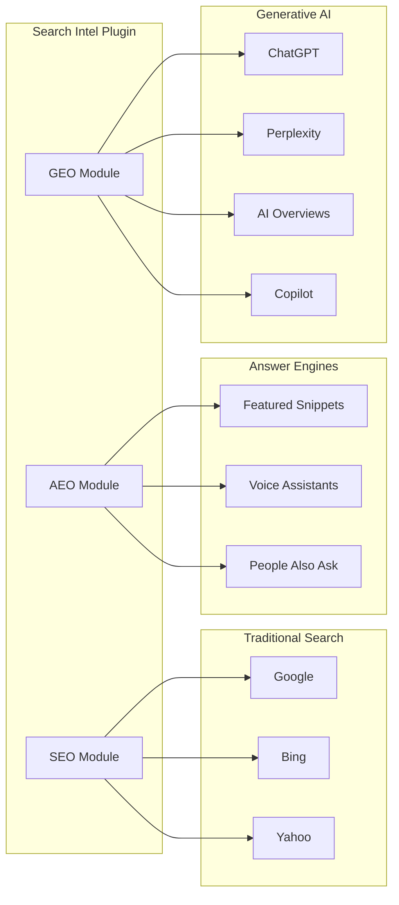

---

## Architecture

### High-Level Module Architecture

```mermaid
graph TD
    BOOT["search-intel.php<br/><i>Bootstrap & Autoloader</i>"]
    CORE["Core<br/><i>Singleton Orchestrator</i>"]
    
    BOOT --> CORE

    CORE --> TITLE["Title Engine"]
    CORE --> SEO["SEO Manager"]
    CORE --> SCHEMA["Schema Manager"]
    CORE --> AEO["AEO Manager"]
    CORE --> GEO["GEO Manager"]
    CORE --> ANALYZER["Content Analyzer"]
    CORE --> SITEMAP["Sitemap"]
    CORE --> ADMIN["Admin<br/><i>only in wp-admin</i>"]
    CORE --> REST["REST API<br/><i>v1.3+</i>"]
    CORE --> BULK["Bulk Tools<br/><i>v1.3+</i>"]
    CORE --> BLOCKS["Blocks<br/><i>v1.4+ Block Editor</i>"]
    CORE --> PRIVACY["Privacy<br/><i>v1.5+ GDPR</i>"]
    CORE --> REDIRECTS["Redirects<br/><i>v2.0+ 301/302/307/410</i>"]
    CORE --> INDEXNOW["IndexNow<br/><i>v2.0+ Ping API</i>"]
    CORE --> WOO["WooCommerce<br/><i>v2.0+ Product Schema</i>"]
    CORE --> LOCALBIZ["Local Business<br/><i>v2.0+ Schema</i>"]
    CORE --> ROBOTSTXT["Robots.txt<br/><i>v2.0+ Editor</i>"]
    CORE --> AUDITLOG["Audit Log<br/><i>v2.0+ Tracking</i>"]
    CORE --> SCHEMATYPES["Schema Types<br/><i>v2.1+ Video, Recipe, etc.</i>"]
    CORE --> QADETECT["Q&A Detector<br/><i>v2.1+ Pattern Engine</i>"]
    CORE --> FAQGEN["FAQ Generator<br/><i>v2.1+ AI-Assisted</i>"]
    CORE --> LINKCHECK["Link Checker<br/><i>v2.0.1+ Broken Links</i>"]
    CORE --> INTLINKER["Internal Linker<br/><i>v2.0.1+ Suggestions</i>"]
    CORE --> CSPHEADERS["CSP Headers<br/><i>v2.0.1+ Security</i>"]
    CORE --> SRI["SRI<br/><i>v2.0.1+ Integrity</i>"]
    CORE --> VISDASH["Visibility Dashboard<br/><i>v2.5+ AI Visibility</i>"]
    CORE --> CITGRAPH["Citation Graph<br/><i>v2.5+ Link Topology</i>"]
    CORE --> AUTHMAP["Authority Map<br/><i>v2.5+ Topic Authority</i>"]
    CORE --> MULTISITE["Multisite<br/><i>v3.0+ Network Settings</i>"]
    CORE --> MIGRATION["Migration<br/><i>v3.0+ SEO Plugin Import</i>"]
    CORE --> RBAC["RBAC<br/><i>v3.0+ Roles &amp; Caps</i>"]
    CORE --> MULTILANG["Multilang<br/><i>v3.0+ WPML/Polylang</i>"]
    CORE --> WHITELABEL["White-Label<br/><i>v3.0+ Reseller Branding</i>"]
    CORE --> SCALE["Scale<br/><i>v3.0+ Queue &amp; Cache</i>"]
    CORE --> MAINWP["MainWP Reporter<br/><i>v3.1+ Child Sync</i>"]
    CORE --> NOTIFY["Notifications<br/><i>v3.1+ Alerts &amp; Digest</i>"]
    CORE --> AIENGINE["AI Engine<br/><i>v3.2+ LLM Abstraction</i>"]
    CORE --> DECAY["Content Decay<br/><i>v3.2+ Score Tracking</i>"]
    CORE --> CANNIBAL["Cannibalization<br/><i>v3.2+ Keyword Detector</i>"]
    CORE --> ADVLINK["Advanced Linking<br/><i>v3.2+ Suggestions</i>"]
    CORE --> ANALYTICS["Historical Analytics<br/><i>v3.3+ Score Charts</i>"]
    CORE --> GA4["GA4 Integration<br/><i>v3.3+ Traffic Correlation</i>"]
    CORE --> CWV["Core Web Vitals<br/><i>v3.3+ PageSpeed</i>"]
    CORE --> REPORTS["Custom Reports<br/><i>v3.3+ PDF/CSV/JSON</i>"]

    TITLE --> TVAR["Variable Resolver"]
    TITLE --> TCTX["Per-Context Templates"]

    SEO --> META["Meta Tags"]
    SEO --> OG["Open Graph"]
    SEO --> TW["Twitter Cards"]
    SEO --> CAN["Canonical URLs"]
    SEO --> ROB["Robots Meta"]

    SCHEMA --> JSONLD["JSON-LD @graph"]
    SCHEMA --> BREAD["BreadcrumbList"]
    SCHEMA --> SITE["WebSite + SearchAction"]
    SCHEMA --> KG["Knowledge Graph"]

    AEO --> FAQ["FAQPage Schema"]
    AEO --> HOWTO["HowTo Schema"]
    AEO --> SPEAK["Speakable"]
    AEO --> AUTODETECT["Auto-detect FAQs"]
    AEO --> DIRECTANS["Direct Answer Meta"]
    AEO --> QAPAT["Q&A Detection"]
    AEO --> SNIPPET["Snippet Scoring"]

    GEO --> AIMETA["AI Meta Tags"]
    GEO --> LLMS["llms.txt Endpoint"]
    GEO --> ENTITY["Entity Markup"]
    GEO --> EEAT["E-E-A-T Schema"]
    GEO --> FRESH["Freshness Signals"]
    GEO --> AIBOT["AI Crawl Directives"]
    GEO --> INTENT["Intent & Audience Meta"]
    GEO --> LOCAL["Local Relevance"]

    ADMIN --> SETTINGS["Settings Pages x6"]
    ADMIN --> METABOX["Post Metabox"]
    ADMIN --> COLUMNS["Admin Columns"]
    ADMIN --> USERFIELDS["User E-E-A-T Fields"]

    REST --> RENDPOINTS["9 Endpoints<br/><i>scores, geo, meta, analyze,<br/>bulk, settings, sitemap</i>"]

    BULK --> BRESCORE["Batch Rescore"]
    BULK --> BREGEN["Batch Regenerate"]
    BULK --> BEXPORT["Export / Import"]

    BLOCKS --> SIDEBAR["Sidebar Panel<br/><i>SEO · AEO · GEO · Analysis</i>"]
    BLOCKS --> BFAQ["FAQ Block"]
    BLOCKS --> BHOWTO["HowTo Block"]
    BLOCKS --> BTOC["TOC Block<br/><i>dynamic</i>"]
    BLOCKS --> BCRUMB["Breadcrumbs Block<br/><i>dynamic</i>"]
    BLOCKS --> BANSWER["Answer Box Block"]
    BLOCKS --> BCITE["Citation Block"]

    PRIVACY --> EXPORTER["Data Exporter<br/><i>wp_privacy_personal_data_exporters</i>"]
    PRIVACY --> ERASER["Data Eraser<br/><i>wp_privacy_personal_data_erasers</i>"]
    PRIVACY --> PPOLICY["Privacy Policy Text<br/><i>wp_add_privacy_policy_content</i>"]

    REDIRECTS --> REXACT["Exact / Prefix / Regex"]
    REDIRECTS --> R404["404 Log + Auto-suggest"]
    REDIRECTS --> RCSV["CSV Import / Export"]
    REDIRECTS --> RSLUG["Slug Change Detection"]

    INDEXNOW --> INBING["Bing / Yandex / Naver"]
    INDEXNOW --> INLOG["Ping Log"]

    WOO --> WPROD["Product Schema"]
    WOO --> WOFFER["Offer + Rating"]
    WOO --> WBREAD["Product Breadcrumbs"]

    LOCALBIZ --> LADDR["PostalAddress + Geo"]
    LOCALBIZ --> LHOURS["Opening Hours"]
    LOCALBIZ --> LMULTI["Multi-Location"]

    ROBOTSTXT --> RTEDIT["Visual Editor"]
    ROBOTSTXT --> RTVALID["Syntax Validation"]

    AUDITLOG --> ALDIFF["Settings Diff"]
    AUDITLOG --> ALUSER["User Attribution"]

    style CORE fill:#2563eb,color:#fff
    style SEO fill:#16a34a,color:#fff
    style AEO fill:#d97706,color:#fff
    style GEO fill:#9333ea,color:#fff
    style TITLE fill:#0d9488,color:#fff
    style ANALYZER fill:#0891b2,color:#fff
    style ADMIN fill:#dc2626,color:#fff
    style REST fill:#ea580c,color:#fff
    style BULK fill:#be185d,color:#fff
    style BLOCKS fill:#7c3aed,color:#fff
    style PRIVACY fill:#059669,color:#fff
    style REDIRECTS fill:#b91c1c,color:#fff
    style INDEXNOW fill:#0369a1,color:#fff
    style WOO fill:#7e22ce,color:#fff
    style LOCALBIZ fill:#a16207,color:#fff
    style ROBOTSTXT fill:#4d7c0f,color:#fff
    style AUDITLOG fill:#64748b,color:#fff
```

### Class Dependency Map

```mermaid
classDiagram
    class Core {
        -instance : Core
        +title_engine : Title_Engine
        +seo : SEO_Manager
        +schema : Schema_Manager
        +aeo : AEO_Manager
        +geo : GEO_Manager
        +analyzer : Content_Analyzer
        +sitemap : Sitemap
        +admin : Admin
        +rest_api : REST_Api
        +bulk_tools : Bulk_Tools
        +blocks : Blocks
        +privacy : Privacy
        +redirects : Redirect_Manager
        +indexnow : IndexNow
        +woocommerce : WooCommerce
        +local_business : Local_Business
        +robots_txt : Robots_Txt
        +audit_log : Audit_Log
        +schema_types : Schema_Types
        +qa_detector : QA_Detector
        +faq_generator : FAQ_Generator
        +link_checker : Link_Checker
        +internal_linker : Internal_Linker
        +csp_headers : CSP_Headers
        +sri : SRI
        +visibility_dashboard : Visibility_Dashboard
        +citation_graph : Citation_Graph
        +authority_map : Authority_Map
        +multisite : Multisite
        +migration : Migration
        +rbac : RBAC
        +multilang : Multilang
        +white_label : White_Label
        +scale : Scale
        +mainwp_reporter : MainWP_Reporter
        +notifications : Notifications
        +ai_engine : AI_Engine
        +content_decay : Content_Decay
        +keyword_cannibalization : Keyword_Cannibalization
        +advanced_linking : Advanced_Linking
        +get_instance() Core
        +get_settings() array
        +get_default_settings() array
    }

    class Title_Engine {
        -settings : array
        +resolve_title() string
        +resolve_variables(template, context) string
        +get_default_templates() array
    }

    class SEO_Manager {
        -settings : array
        +get_title(post_id) string
        +get_description(post_id) string
        +render_meta_tags() void
        +render_canonical() void
        +render_robots_meta() void
        +render_open_graph() void
        +render_twitter_card() void
    }

    class Schema_Manager {
        -settings : array
        +render_schema() void
        +get_singular_schema(post_id) array
        -get_knowledge_graph() array
        -get_website_schema() array
        -get_breadcrumbs_schema() array
    }

    class AEO_Manager {
        -settings : array
        +get_faq_schema(post_id) array
        +get_howto_schema(post_id) array
        +render_speakable() void
        +render_direct_answer_meta() void
        +detect_qa_patterns(content) array
        +get_snippet_score(content) array
        +auto_lead_summary(excerpt, post) string
        +get_aeo_score(post_id) array
        -auto_detect_faqs(post_id) array
    }

    class GEO_Manager {
        -settings : array
        +render_ai_meta() void
        +serve_llms_txt() void
        +enhance_content_entities(content) string
        +render_author_eeat() void
        +get_geo_score(post_id) array
        -auto_extract_topics(post_id) array
    }

    class Content_Analyzer {
        -settings : array
        +analyze(post_id, content, title, keyword, desc) array
        +get_readability_score(text) array
        +ajax_analyze() void
        +analyze_on_save(post_id, post) void
        -get_content_checks(post_id, content, text, word_count) array
        -count_syllables(text) int
    }

    class Sitemap {
        -settings : array
        +register_endpoints() void
        +serve_sitemap() void
        +ping_search_engines(post_id) void
        +invalidate_cache() void
        -generate_sitemap_index() string
        -generate_sitemap(type, page) string
    }

    class Admin {
        -settings : array
        -core : Core
        +register_menu() void
        +register_metaboxes() void
        +save_metabox_data(post_id) void
        +render_user_eeat_fields(user) void
    }

    class REST_Api {
        -settings : array
        -core : Core
        +register_routes() void
        +get_scores(request) WP_REST_Response
        +get_geo(request) WP_REST_Response
        +get_meta(request) WP_REST_Response
        +update_meta(request) WP_REST_Response
        +analyze(request) WP_REST_Response
    }

    class Bulk_Tools {
        -settings : array
        -core : Core
        +ajax_bulk_rescore() void
        +ajax_bulk_regenerate() void
        +ajax_export_settings() void
        +ajax_import_settings() void
    }

    class Blocks {
        -META_KEYS : array
        +register_blocks() void
        +register_meta() void
        +enqueue_sidebar() void
        +render_toc(attributes, content) string
        +render_breadcrumbs(attributes, content) string
    }

    class Privacy {
        -USER_META_KEYS : array
        +register_exporter(exporters) array
        +register_eraser(erasers) array
        +export_personal_data(email, page) array
        +erase_personal_data(email, page) array
        +add_privacy_policy_content() void
    }

    class Redirect_Manager {
        -settings : array
        +maybe_redirect() void
        +log_404() void
        +find_matching_redirect(path) object
        +save_redirect(data) int
        +delete_redirect(id) bool
        +export_csv() string
        +import_csv(csv) array
        +detect_slug_change(post_id, post, before) void
        +create_tables() void
    }

    class IndexNow {
        -settings : array
        +ping_on_publish(post_id) void
        +submit_url(url) array
        +serve_key_file() void
        +get_log() array
        +clear_log() void
    }

    class WooCommerce {
        -settings : array
        +is_woocommerce_active() bool
        +inject_product_schema(schema, post_id) array
        +get_offer_schema(product) array
        +get_aggregate_rating(product) array
        +product_breadcrumbs(crumbs, post_id) array
    }

    class Local_Business {
        -settings : array
        +render_schema() void
        +build_location_schema(location) array
        +build_address(location) array
        +build_geo(location) array
        +build_opening_hours(location) array
    }

    class Robots_Txt {
        -settings : array
        +filter_robots_txt(output, public) string
        +get_content() string
        +save_content(content) bool
        +validate(content) array
    }

    class Audit_Log {
        -settings : array
        +log_settings_change(old, new) void
        +add_entry(action, details) void
        +get_log() array
        +clear_log() void
        +diff_settings(old, new) array
    }

    Core --> Title_Engine
    Core --> SEO_Manager
    Core --> Schema_Manager
    Core --> AEO_Manager
    Core --> GEO_Manager
    Core --> Content_Analyzer
    Core --> Sitemap
    Core --> Admin
    Core --> REST_Api
    Core --> Bulk_Tools
    Core --> Blocks
    Core --> Privacy
    Core --> Redirect_Manager
    Core --> IndexNow
    Core --> WooCommerce
    Core --> Local_Business
    Core --> Robots_Txt
    Core --> Audit_Log
    Core --> Schema_Types
    Core --> QA_Detector
    Core --> FAQ_Generator
    Core --> Link_Checker
    Core --> Internal_Linker
    Core --> CSP_Headers
    Core --> SRI
    Core --> Visibility_Dashboard
    Core --> Citation_Graph
    Core --> Authority_Map
    Core --> Multisite
    Core --> Migration
    Core --> RBAC
    Core --> Multilang
    Core --> White_Label
    Core --> Scale
    Core --> MainWP_Reporter
    Core --> Notifications
    Core --> AI_Engine
    Core --> Content_Decay
    Core --> Keyword_Cannibalization
    Core --> Advanced_Linking
    Admin --> Core
    REST_Api --> Core
    Bulk_Tools --> Core

    class MainWP_Reporter {
        -settings : array
        +is_mainwp_active() bool
        +inject_sync_data(data) array
        +get_site_summary() array
        +get_aggregate_scores() array
        +handle_callback(action, data) array
    }

    class Notifications {
        -settings : array
        +schedule_events() void
        +get_thresholds() array
        +snapshot_post_scores(post_id, scores) void
        +check_score_drops() void
        +send_weekly_digest() void
        +send_slack_alert(message) bool
        +register_dashboard_widget() void
        +build_digest_summary() array
        +get_notification_email() string
    }

    class Migration {
        -settings : array
        +detect_sources() array
        +migrate(source, options) array
        +dry_run(source) array
        +render_admin_page() void
    }

    class RBAC {
        -settings : array
        +ensure_role_exists() void
        +check_module_access(user_id, module) bool
        +grant_module(user_id, module) void
        +revoke_module(user_id, module) void
        +get_permissions_summary() array
    }

    class Scale {
        -settings : array
        +enqueue_job(type, post_id) void
        +process_queue() void
        +cache_get(key) mixed
        +cache_set(key, value) bool
        +render_admin_page() void
    }

    class White_Label {
        -settings : array
        +get_config() array
        +filter_plugin_meta(plugins) array
        +get_custom_name() string
        +export_reseller_config() array
        +import_reseller_config(config) bool
    }

    class AI_Engine {
        -settings : array
        +get_providers() array
        +get_active_provider() string
        +get_model() string
        +encrypt(plaintext) string
        +decrypt(ciphertext) string
        +save_api_key(provider, key) void
        +get_api_key(provider) string
        +is_configured() bool
        +is_rate_limited() bool
        +is_budget_exceeded() bool
        +chat(system, user, options) array
        +generate_meta_description(content, keyword, title) array
        +generate_title_suggestions(content, keyword, title) array
        +generate_link_recommendations(post_id, candidates, content) array
        +generate_content_brief(topic, titles, gaps) array
    }

    class Content_Decay {
        -settings : array
        +store_snapshot(post_id, scores) void
        +get_score_history(post_id) array
        +detect_decay(post_id) array
        +run_decay_check() array
        +get_decaying_posts(limit) array
        +get_refresh_suggestions(post_id) array
        +get_trend_data(post_id, module, days) array
        +get_score_change(post_id, module, days) array
    }

    class Keyword_Cannibalization {
        -settings : array
        +build_keyword_index(post_type) array
        +normalize_keyword(keyword) string
        +generate_report(use_cache) array
        +suggest_action(posts) array
        +get_link_relationships(post_ids) array
        +get_summary() array
    }

    class Advanced_Linking {
        -settings : array
        +get_suggestions(post_id, content, limit) array
        +extract_keywords(text) array
        +is_orphaned(post_id) bool
        +get_orphaned_posts(limit) array
        +get_equity_flow(limit) array
        +check_internal_links(post_id) array
        +run_broken_link_check() array
    }
```

---

## Data Flow

### Frontend Output Pipeline

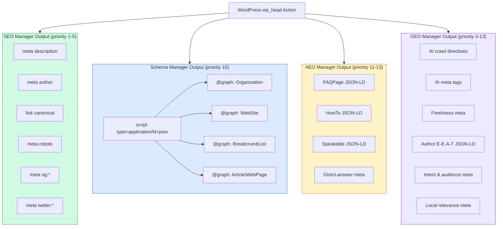

### Post Editor Data Flow

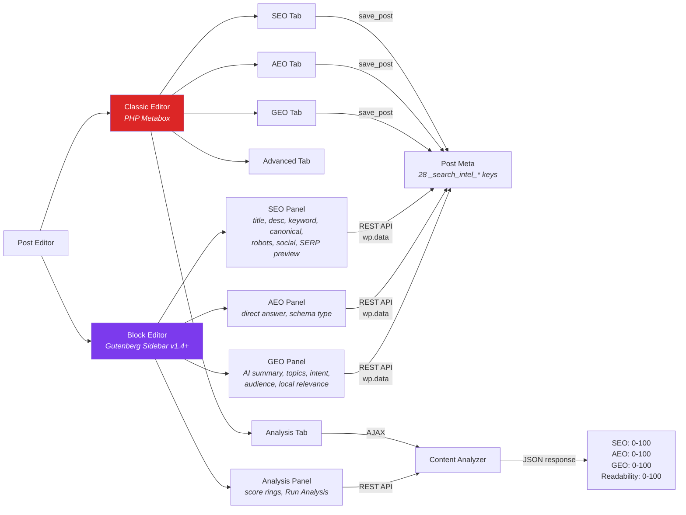

### Sitemap Request Flow

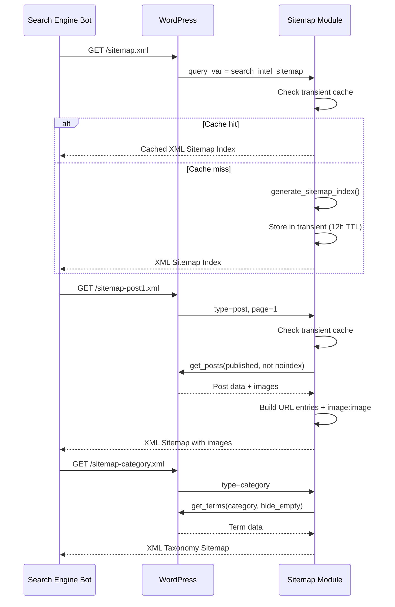

### llms.txt Request Flow

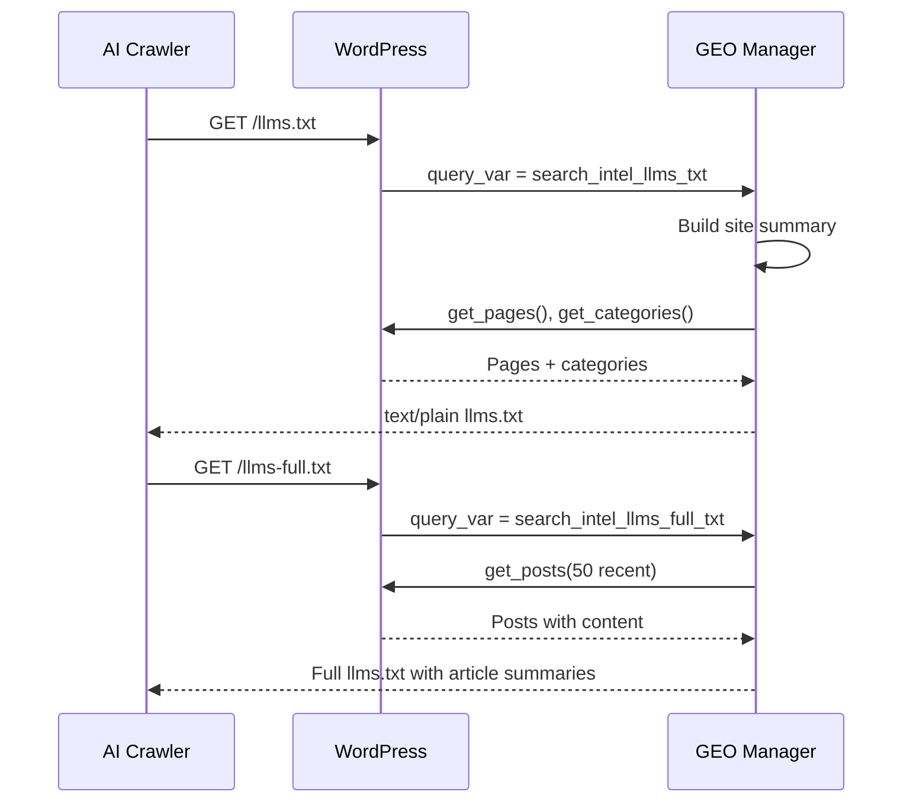

---

## Admin Interface

### Settings Page Structure

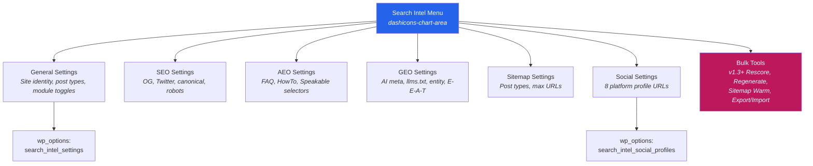

---

## Block Editor Architecture (v1.4+)

### Gutenberg Sidebar & Blocks Data Flow

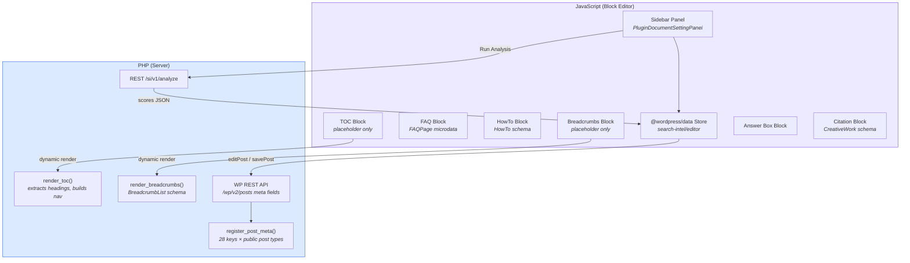

### Block Registration Pipeline

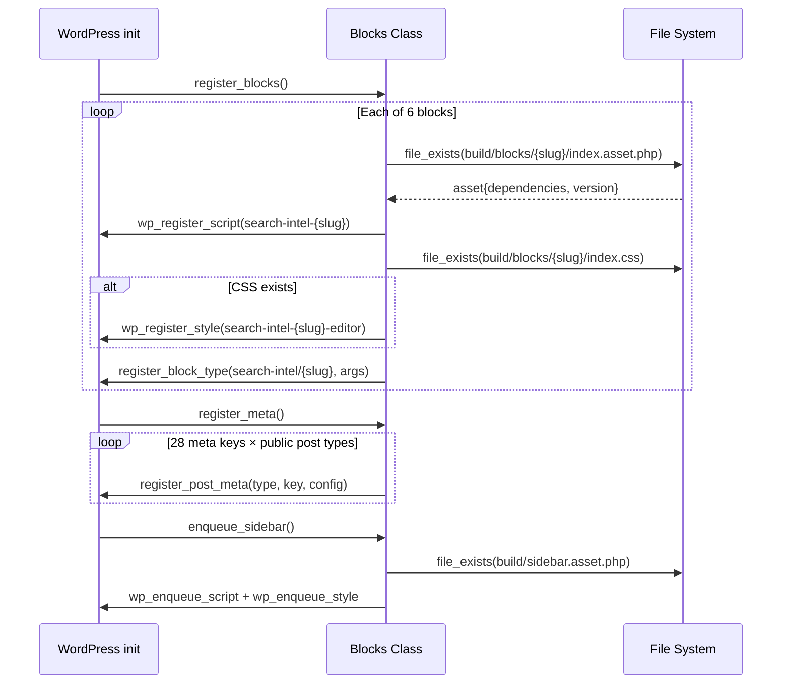

---

## Schema Output Pipeline

### JSON-LD Graph Assembly

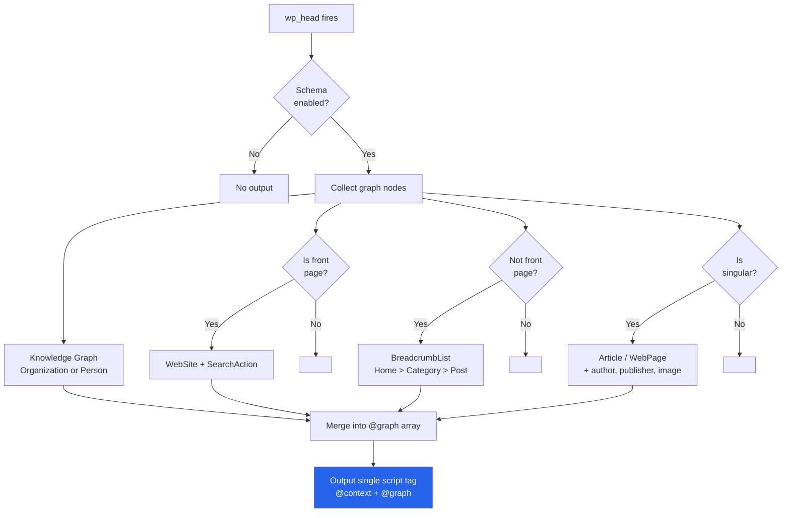

---

## Scoring System

### SEO Score Breakdown (100 points)

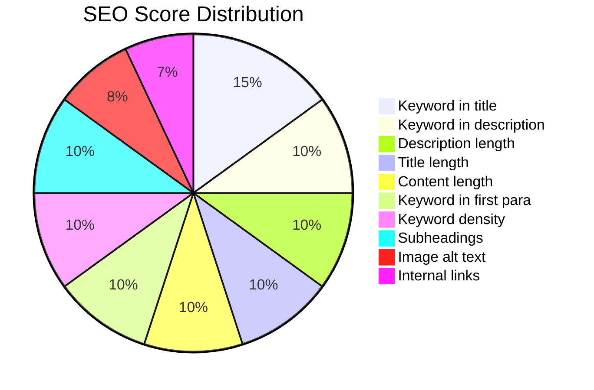

### AEO Score Breakdown (100 points)

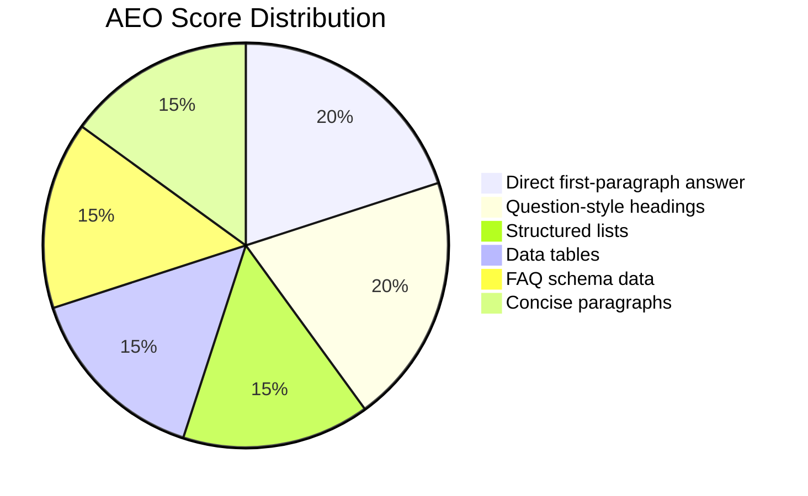

### GEO Score Breakdown (100 points)

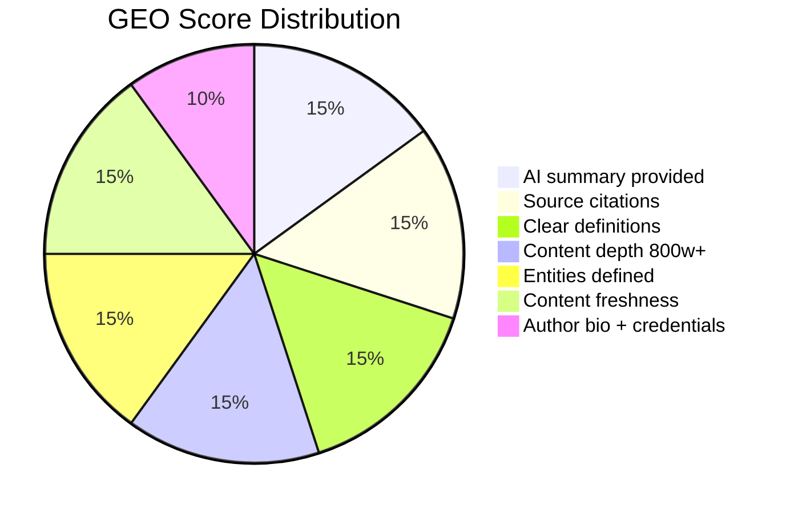

### Score Rating Thresholds

| Score Range | Rating | Color | Meaning |
|-------------|--------|-------|---------|
| 70 - 100 | Good | Green | Well optimized |
| 40 - 69 | Needs Work | Amber | Key improvements needed |
| 0 - 39 | Poor | Red | Significant optimization required |

---

## Installation

### Requirements

| Requirement | Minimum | Recommended |
|-------------|---------|-------------|
| WordPress | 6.0 | 6.5+ |
| PHP | 7.4 | 8.1+ |
| MySQL | 5.7 | 8.0+ |

### Steps

1. Download or clone this repository
2. Copy the `search-intel` folder to `wp-content/plugins/`
3. Activate via **Plugins > Installed Plugins**
4. Navigate to **Search Intel > General** to configure
5. Flush permalinks: **Settings > Permalinks > Save** (required for sitemap and llms.txt)

### Important

> **Deactivate other SEO plugins** (Yoast, Rank Math, All in One SEO, etc.) before activating Search Intel to avoid duplicate meta tags and schema conflicts.

---

## Configuration

### Quick Start

1. **General** — Set your site name, entity type (Organization/Person), and logo
2. **SEO** — Enable Open Graph, Twitter Cards, and robots settings
3. **AEO** — Enable FAQ/HowTo schema and Speakable
4. **GEO** — Enable AI meta, llms.txt, and entity markup
5. **Social** — Add your social profile URLs
6. **Sitemap** — Choose which post types to include

### Per-Post Settings

Every post and page gets a **Search Intel** metabox with five tabs:

| Tab | Fields |
|-----|--------|
| **SEO** | Title, description, focus keyword, canonical URL, noindex/nofollow, SERP preview, social title/description/image, secondary keywords |
| **AEO** | FAQ items (repeater), schema type override, direct-answer field, citation/source references repeater |
| **GEO** | AI summary, topics, expertise level, content type, fact-check date, entities, content intent, audience, author expertise notes, local relevance toggle + location |
| **Advanced** | AI crawler blocking |
| **Analysis** | Live SEO/AEO/GEO/Readability scores with actionable checks + 11 content quality checks |

---

## REST API

Search Intel exposes a REST API under the `search-intel/v1` namespace. Enable it via **Search Intel > GEO > Enable REST API**.

All endpoints use standard WordPress REST authentication (cookie, application passwords, or OAuth).

### Endpoints

| Method | Route | Permission | Description |
|--------|-------|------------|-------------|
| `GET` | `/search-intel/v1/scores/{id}` | `read` (published) | SEO, AEO, GEO, readability scores |
| `GET` | `/search-intel/v1/geo/{id}` | `read` (published) | Full GEO metadata (AI summary, topics, entities, intent, audience) |
| `GET` | `/search-intel/v1/meta/{id}` | `read` (published) | SEO meta fields (title, description, keyword, canonical, robots) |
| `PUT` | `/search-intel/v1/meta/{id}` | `edit_post` | Update SEO meta fields |
| `POST` | `/search-intel/v1/analyze/{id}` | `edit_post` | Run content analysis and save scores |
| `POST` | `/search-intel/v1/bulk/rescore` | `manage_options` | Batch rescore with offset pagination |
| `GET` | `/search-intel/v1/settings` | `manage_options` | Read all plugin settings |
| `PUT` | `/search-intel/v1/settings` | `manage_options` | Update plugin settings |
| `POST` | `/search-intel/v1/sitemap/invalidate` | `manage_options` | Clear sitemap transient caches |

### Example

```bash
# Get scores for post 42
curl -u admin:APP_PASSWORD https://example.com/wp-json/search-intel/v1/scores/42

# Trigger analysis
curl -X POST -u admin:APP_PASSWORD https://example.com/wp-json/search-intel/v1/analyze/42

# Export settings
curl -u admin:APP_PASSWORD https://example.com/wp-json/search-intel/v1/settings
```

---

## WP-CLI Commands

Search Intel registers a `search-intel` WP-CLI command group with the following subcommands:

```bash
# Analyze a single post (displays score table)
wp search-intel analyze 42
wp search-intel analyze 42 --save        # Save scores to post meta

# Bulk rescore all published posts
wp search-intel rescore --all
wp search-intel rescore --all --post_type=page --batch_size=100

# Bulk regenerate empty metadata (descriptions, AI summaries, content types)
wp search-intel regenerate --all
wp search-intel regenerate --all --post_type=page

# Sitemap cache management
wp search-intel sitemap cache             # Clear + queue regeneration
wp search-intel sitemap clear             # Clear caches only

# Settings export/import
wp search-intel export > settings.json
wp search-intel import settings.json
wp search-intel import settings.json --mode=overwrite

# Display score table
wp search-intel scores
wp search-intel scores --format=csv --limit=100
wp search-intel scores --orderby=seo

# Migration (v3.0+)
wp search-intel migrate --from=yoast             # Migrate from Yoast SEO
wp search-intel migrate --from=rankmath --dry-run # Preview migration
wp search-intel migrate --from=aioseo --overwrite # Overwrite existing data

# RBAC (v3.0+)
wp search-intel rbac grant 5 seo                 # Grant SEO module to user 5
wp search-intel rbac revoke 5 geo                # Revoke GEO module from user 5
wp search-intel rbac list                        # List all user permissions

# Multisite (v3.0+)
wp search-intel multisite push-defaults          # Push network defaults to all sites
wp search-intel multisite report --format=table  # Network-wide score report

# Background Queue (v3.0+)
wp search-intel queue status                     # Show queue status
wp search-intel queue process --batch=10         # Manually process queued jobs

# White-Label (v3.0+)
wp search-intel white-label export > brand.json  # Export reseller config
wp search-intel white-label import < brand.json  # Import reseller config
```

---

## Bulk Tools

Navigate to **Search Intel > Bulk Tools** in the WordPress admin to access:

- **Bulk Rescore** — re-run SEO/AEO/GEO/readability analysis on all published posts with a live progress bar
- **Bulk Regenerate Metadata** — auto-fill empty descriptions, AI summaries, and content types (existing values are never overwritten)
- **Sitemap Cache** — clear all sitemap transient caches and queue regeneration
- **Export Settings** — download all plugin settings + social profiles as a timestamped JSON file
- **Import Settings** — upload a JSON file with **merge** (overlay on current) or **overwrite** (reset to defaults first) mode

All bulk operations are batched via AJAX (20 posts per request) with a progress bar, so they won't time out on large sites.

---

## Gutenberg Sidebar

Search Intel adds a native **PluginDocumentSettingPanel** to the Block Editor with four tabs:

### SEO Tab
- **SEO Title** — custom title tag with character count (60 max)
- **Meta Description** — custom description with character count (160 max)
- **Focus Keyword** — primary keyword for content analysis
- **Secondary Keywords** — comma-separated additional keywords
- **Canonical URL** — override the canonical URL
- **noindex / nofollow** — toggle robots directives
- **Social Overrides** — collapsible panel for OG and Twitter title/description
- **SERP Preview** — live preview of how the page appears in Google results

### AEO Tab
- **Direct Answer** — concise answer for featured snippets and voice assistants (300 char limit)
- **Schema Type Override** — select Article, NewsArticle, BlogPosting, HowTo, FAQPage, or Review (default: auto-detect)
- **FAQ & HowTo Guidance** — prompts to use the dedicated blocks for structured data

### GEO Tab
- **AI Summary** — factual summary for LLM consumption (500 char limit)
- **Key Topics** — comma-separated topics for AI indexing
- **Content Type** — article, how-to, faq, comparison, review, guide, news, opinion
- **Content Intent** — informational, navigational, transactional, commercial
- **Target Audience** — general, beginner, intermediate, expert, professional
- **Expertise Level** — beginner through expert
- **Fact-Check Date** — date picker for freshness signals
- **Local Relevance** — toggle with conditional location field

### Analysis Tab
- **Score Rings** — SVG ring visualizations for SEO, AEO, GEO, and Readability scores (color-coded: green ≥80, yellow ≥50, red <50)
- **Run Analysis** — one-click analysis via the REST API with spinner feedback
- **Check Results** — categorized pass/fail/info items from the content analyzer

> **Classic Editor users**: The existing PHP metabox continues to work unchanged. The Gutenberg sidebar is only loaded in the Block Editor.

---

## Custom Blocks

Search Intel provides 6 custom Gutenberg blocks under the `search-intel` namespace:

### `search-intel/faq`
Visual FAQ editor with numbered question/answer pairs. Add, remove, and reorder items directly in the editor. Outputs microdata with `itemScope`/`itemProp` attributes and a `data-schema="FAQPage"` data attribute for JSON-LD generation.

### `search-intel/howto`
Step-by-step tutorial editor with a title, description, optional total time (ISO 8601), and per-step name, instructions, and image upload via `MediaUpload`. Outputs an ordered list with HowTo schema data attributes.

### `search-intel/toc`
Auto-generated Table of Contents from headings in the post. Updates in real-time as you add or edit headings. Settings: max heading depth (1–6) and ordered/unordered list. **Dynamic block** — rendered server-side via `render_toc()` on the frontend.

### `search-intel/breadcrumbs`
Theme-aware breadcrumb navigation with configurable separator (`›`, `/`, `»`, `→`, `|`) and home label. Outputs a full `BreadcrumbList` schema with `itemListElement` microdata. **Dynamic block** — rendered server-side via `render_breadcrumbs()` with category hierarchy.

### `search-intel/answer-box`
Highlighted answer container optimized for featured snippet extraction. Question + answer fields with `data-si-answer-box` and `data-si-direct-answer` attributes for AI and search engine parsing.

### `search-intel/citation`
Inline source citation block wrapping quoted text with source metadata. Inspector panel for source name, URL, type (website, journal, book, report, news, government), author, and date. Outputs a `<figure>` with `CreativeWork` microdata.

> **FSE Templates**: The TOC, Breadcrumbs, and FAQ blocks are all usable in Full Site Editing templates (`header.html`, `single.html`, etc.).

---

## Shortcodes

### FAQ Block

```
[search_intel_faq question="What is SEO?" answer="SEO stands for Search Engine Optimization."]
```

### HowTo Block

```
[search_intel_howto name="How to Install a Plugin" time="PT5M"]
  Step content here...
[/search_intel_howto]
```

---

## Hooks and Filters

### Filters

| Filter | Description | Parameters |
|--------|-------------|------------|
| `search_intel_singular_schema` | Modify article/page schema before output | `$schema`, `$post_id` |

### Actions

All output hooks fire on `wp_head` with the following priorities:

| Priority | Module | Output |
|----------|--------|--------|
| 1 | SEO Manager | Meta description, author |
| 2 | SEO Manager | Canonical URL |
| 3 | SEO Manager / GEO | Robots meta, AI crawl directives |
| 4 | SEO Manager | Open Graph tags (with social overrides) |
| 5 | SEO Manager | Twitter Card tags (with social overrides) |
| 6 | GEO Manager | AI meta tags + intent, audience, expertise, local relevance |
| 7 | GEO Manager | Freshness meta |
| 10 | Schema Manager | JSON-LD @graph (with citations, audience, contentLocation) |
| 11 | AEO Manager | FAQ / HowTo schema |
| 12 | AEO Manager | Speakable schema |
| 13 | AEO Manager | Direct-answer meta tag |
| 13 | GEO Manager | Author E-E-A-T schema |
| 20 | SEO Manager | Document title filter |
| 25 | Title Engine | Template-based title resolution |

---

## File Structure

```
search-intel/
├── search-intel.php              # Main plugin bootstrap + autoloader + WP-CLI registration
├── uninstall.php                 # Database cleanup on uninstall
├── readme.txt                    # WordPress.org readme
├── README.md                     # This file
├── LICENSE.md                    # GPL-2.0-or-later
├── CHANGELOG.md                  # Version history
├── ROADMAP.md                    # Development roadmap
├── webpack.config.js             # @wordpress/scripts build config (7 entry points)
│
├── includes/
│   ├── class-core.php            # Singleton orchestrator + default settings
│   ├── class-title-engine.php    # Title template engine with variable resolver
│   ├── class-seo-manager.php     # Meta, OG, Twitter, canonical, robots
│   ├── class-schema-manager.php  # JSON-LD structured data (+ citations, audience, location)
│   ├── class-aeo-manager.php     # FAQ, HowTo, Speakable, direct-answer, Q&A detection
│   ├── class-geo-manager.php     # AI meta, llms.txt, entities, E-E-A-T, intent, local
│   ├── class-content-analyzer.php# Scoring engine + analysis-on-save + 11 content checks
│   ├── class-sitemap.php         # XML sitemap with images + transient caching
│   ├── class-admin.php           # Settings, metaboxes, user fields, Bulk Tools page
│   ├── class-rest-api.php        # REST API controller (search-intel/v1 namespace)
│   ├── class-bulk-tools.php      # Bulk rescore, regenerate, export/import (AJAX)
│   ├── class-cli.php             # WP-CLI commands (analyze, rescore, scores, rbac, multisite, queue, white-label)
│   ├── class-blocks.php          # Block editor: sidebar, custom blocks, meta registration
│   ├── class-privacy.php         # GDPR: data exporter, eraser, privacy policy (v1.5+)
│   ├── class-redirect-manager.php # 301/302/307/410 redirects, 404 log, CSV (v2.0+)
│   ├── class-indexnow.php        # IndexNow ping on publish (Bing, Yandex, Naver) (v2.0+)
│   ├── class-woocommerce.php     # Product schema, offers, breadcrumbs (v2.0+)
│   ├── class-local-business.php  # LocalBusiness schema, multi-location (v2.0+)
│   ├── class-robots-txt.php      # Visual robots.txt editor with validation (v2.0+)
│   ├── class-audit-log.php       # Settings change tracking with diffs (v2.0+)
│   ├── class-link-checker.php    # Broken link scanner via WP-Cron (v2.0.1+)
│   ├── class-internal-linker.php # Internal linking suggestions (v2.0.1+)
│   ├── class-csp-headers.php     # Content Security Policy headers (v2.0.1+)
│   ├── class-sri.php             # Subresource Integrity hashes (v2.0.1+)
│   ├── class-schema-types.php    # Video, Recipe, Event, Review, etc. (v2.1+)
│   ├── class-qa-detector.php     # Q&A pattern detection engine (v2.1+)
│   ├── class-faq-generator.php   # AI-assisted FAQ generation (v2.1+)
│   ├── class-visibility-dashboard.php # AI visibility health score (v2.5+)
│   ├── class-citation-graph.php  # Internal link graph & topic clusters (v2.5+)
│   ├── class-authority-map.php   # Topical authority scoring (v2.5+)
│   ├── class-multisite.php       # Network defaults & per-site overrides (v3.0+)
│   ├── class-migration.php       # SEO plugin migration engine (v3.0+)
│   ├── class-rbac.php            # Role-based access control (v3.0+)
│   ├── class-multilang.php       # WPML/Polylang integration (v3.0+)
│   ├── class-white-label.php     # Reseller branding & config (v3.0+)
│   ├── class-scale.php           # Object cache, queue, bulk editor (v3.0+)
│   ├── class-mainwp-reporter.php # MainWP child-side reporter (v3.1+)
│   ├── class-notifications.php   # Email digest, score alerts, Slack, widget (v3.1+)
│   ├── class-ai-engine.php       # LLM abstraction: OpenAI, Anthropic, Ollama (v3.2+)
│   ├── class-content-decay.php   # Score history, decay detection, refresh suggestions (v3.2+)
│   ├── class-keyword-cannibalization.php # Duplicate keyword detector & report (v3.2+)
│   ├── class-advanced-linking.php # Link suggestions, orphans, equity, broken links (v3.2+)
│   ├── class-historical-analytics.php # Per-post score charts, site-wide trends (v3.3+)
│   ├── class-ga4-integration.php # GA4 traffic correlation, opportunities (v3.3+)
│   ├── class-core-web-vitals.php # PageSpeed Insights, CWV tracking (v3.3+)
│   └── class-custom-reports.php  # PDF/CSV/JSON export, scheduled reports (v3.3+)
│
├── src/                           # Block editor source (compiled to build/)
│   ├── store/
│   │   └── index.js              # @wordpress/data store (search-intel/editor)
│   ├── sidebar/
│   │   ├── index.js              # PluginDocumentSettingPanel registration
│   │   ├── sidebar.css           # Sidebar styles (tabs, SERP preview, score rings)
│   │   └── panels/
│   │       ├── seo-panel.js      # SEO fields + SERP preview + social overrides
│   │       ├── aeo-panel.js      # Direct answer + schema type override
│   │       ├── geo-panel.js      # AI summary, topics, intent, audience, local
│   │       └── score-panel.js    # Score rings + Run Analysis + check results
│   └── blocks/
│       ├── faq/                  # FAQ block (edit, save, editor CSS)
│       ├── howto/                # HowTo block (edit, save, editor CSS)
│       ├── toc/                  # Table of Contents block (dynamic)
│       ├── breadcrumbs/          # Breadcrumbs block (dynamic)
│       ├── answer-box/           # Answer Box block (edit, save, editor CSS)
│       └── citation/             # Citation block (edit, save, editor CSS)
│
├── build/                         # Compiled assets (sidebar.js, blocks/*/index.js)
│
├── admin/
│   ├── css/
│   │   └── admin-style.css       # Admin UI styles + bulk tools progress bars
│   ├── js/
│   │   ├── admin-script.js       # Tabs, SERP preview, repeaters, AJAX analysis
│   │   └── bulk-tools.js         # Batch AJAX processing with progress UI
│   └── views/
│       ├── metabox.php           # Post editor metabox (SEO, AEO, GEO, Advanced, Analysis)
│       ├── settings-general.php  # General settings page
│       ├── settings-seo.php      # SEO settings (+ OG defaults, descriptions, robots, titles)
│       ├── settings-aeo.php      # AEO settings page
│       ├── settings-geo.php      # GEO settings (+ content defaults, REST API toggle)
│       ├── settings-sitemap.php  # Sitemap settings (+ taxonomy toggles)
│       ├── settings-social.php   # Social profiles page
│       └── bulk-tools.php        # Bulk Tools admin page
│
└── languages/                    # Translation files (i18n ready)
```

---

## Compatibility

| Environment | Status | Notes |
|-------------|--------|-------|
| WordPress 6.0 - 6.7 | Supported | Tested across major versions |
| Full Site Editing (FSE) themes | Supported | Works via `wp_head` hook |
| Classic themes | Supported | Full compatibility |
| Block Editor (Gutenberg) | Supported | Reads content via `wp.data` |
| Classic Editor | Supported | TinyMCE + textarea fallback |
| PHP 7.4 - 8.3 | Supported | Typed properties, null coalescing |
| MySQL 5.7+ / MariaDB 10.3+ | Supported | Standard meta queries |
| Multisite | Compatible | Per-site settings |

---

## Testing & CI

Search Intel has a comprehensive automated test suite and CI pipeline.

### Test Coverage

| Suite | Count | Framework |
|-------|-------|-----------|
| Unit tests | 828 tests, 1,880 assertions | PHPUnit 9.6 |
| Integration tests | 125 tests, 202 assertions | PHPUnit 9.6 |
| E2E tests | 58 tests (51 pass, 7 skip) | Playwright (Chromium) |

### Static Analysis & Linting

| Tool | Level / Standard | Status |
|------|-----------------|--------|
| Psalm | Level 4 | Passing (with WP stubs baseline) |
| PHPStan | Level 6 | Passing |
| PHPCS | WordPress-Core (WPCS 3.0) | Informational |
| ESLint | Custom config | Informational |
| Stylelint | stylelint-config-standard | Passing (0 errors) |

### Performance Benchmarks

| Metric | Result | Target |
|--------|--------|--------|
| `wp_head` full pipeline | < 10ms | < 10ms |
| Sitemap cold (1000+ posts) | 65ms | < 500ms |
| Content analysis | < 200ms | < 200ms |

### CI Pipeline (GitHub Actions)

- PHPUnit on PHP 8.1, 8.2, 8.3
- Psalm level 4, PHPStan level 6, PHPCS, ESLint, Stylelint
- Performance regression checks
- Playwright E2E via `wp-env` (Docker)

### Running Tests Locally

```bash
# Unit + integration tests
composer install
vendor/bin/phpunit --testsuite unit
vendor/bin/phpunit --testsuite integration

# E2E tests (requires Docker)
npm install
npx wp-env start
npx playwright test

# Static analysis
vendor/bin/psalm --no-cache
npx stylelint "admin/css/**/*.css"
```

---

## Security

- All user input sanitized with `sanitize_text_field()`, `wp_kses_post()`, `esc_url_raw()`
- All output escaped with `esc_html()`, `esc_attr()`, `esc_url()`
- Nonce verification on all form submissions and AJAX calls
- Capability checks (`manage_options`, `edit_post`, `edit_user`) on all write operations
- No direct file access — all PHP files check `ABSPATH`
- No external API calls except optional search engine pinging (non-blocking)
- No JavaScript on the public frontend — zero attack surface
- Rate limiting on AJAX content analysis (10 requests/min per user)

---

## Contributing

See [CONTRIBUTING.md](CONTRIBUTING.md) for full details on branching strategy, commit conventions, and local development setup.

1. Fork the repository
2. Create a feature branch from `develop`: `git checkout -b feature/my-feature develop`
3. Follow WordPress coding standards (WPCS) and [Conventional Commits](https://www.conventionalcommits.org/)
4. Write tests for new functionality
5. Submit a pull request against `develop`

---

## License

Search Intel is licensed under the [GNU General Public License v2.0 or later](LICENSE.md).
