# Search Intel — Development Roadmap

> A phased plan covering feature completion, security, privacy, testing, Full Site Editing (FSE) compatibility, classic theme support, bulk tools, REST API, and long-term vision.

---

## Table of Contents

- [Spec Gap Analysis](#spec-gap-analysis)
- [Roadmap Overview](#roadmap-overview)
- [Phase 1 — Feature Completion (v1.1)](#phase-1--feature-completion-v11)
- [Phase 2 — Hardening & Testing (v1.2)](#phase-2--hardening--testing-v12)
- [Phase 3 — Bulk Tools & REST API (v1.3)](#phase-3--bulk-tools--rest-api-v13)
- [Phase 4 — FSE & Block Editor Native (v1.4)](#phase-4--fse--block-editor-native-v14)
- [Phase 5 — Privacy & Compliance (v1.5)](#phase-5--privacy--compliance-v15)
- [Phase 6 — Advanced SEO (v2.0)](#phase-6--advanced-seo-v20)
- [Phase 7 — Advanced AEO (v2.1)](#phase-7--advanced-aeo-v21)
- [Phase 8 — Advanced GEO (v2.5)](#phase-8--advanced-geo-v25)
- [Phase 9 — Enterprise & Scale (v3.0)](#phase-9--enterprise--scale-v30)
- [Long-Term Vision](#long-term-vision)
- [Compatibility Matrix](#compatibility-matrix)
- [Security Roadmap](#security-roadmap)
- [Privacy Roadmap](#privacy-roadmap)
- [Testing Strategy](#testing-strategy)

---

## Spec Gap Analysis

Features from the full specification that are **not yet implemented** in v1.0 and must be addressed:

### Post-Level Panel — Missing Fields

| Field | Status | Target |
|-------|--------|--------|
| Social share title (separate from SEO title) | Missing | v1.1 |
| Social share description | Missing | v1.1 |
| Social image override (UI in metabox) | Missing UI | v1.1 |
| Secondary keywords | Missing | v1.1 |
| Per-post author expertise notes | Missing | v1.1 |
| Citation / source references (structured) | Missing | v1.1 |
| Direct-answer field ("What is this post answering?") | Missing | v1.1 |
| Local relevance toggle | Missing | v1.1 |
| Content intent label (informational, commercial, navigational, educational) | Missing | v1.1 |
| Audience label (beginner, professional, general, etc.) | Missing | v1.1 |

### Automated Analysis — Missing Checks

| Check | Status | Target |
|-------|--------|--------|
| Auto-analyze on save (not just on-demand) | Missing | v1.1 |
| H1 presence / missing H1 pattern detection | Missing | v1.1 |
| Internal link opportunity suggestions | Partial (count only) | v1.1 |
| External citation presence scoring | Missing | v1.1 |
| Answer block opportunity detection | Missing | v1.1 |
| Entity clarity scoring | Missing | v1.1 |
| Summary/AI-summary presence check | Missing | v1.1 |
| Schema completeness check | Missing | v1.1 |

### AEO Output — Missing

| Feature | Status | Target |
|---------|--------|--------|
| Excerpt / summary block auto-generation | Missing | v1.1 |
| Q&A style detection (separate from FAQ) | Missing | v1.1 |
| Answer snippet recommendation score | Missing | v1.1 |
| Direct-answer field in structured data | Missing | v1.1 |

### GEO Output — Missing

| Feature | Status | Target |
|---------|--------|--------|
| Source references / citations in JSON-LD | Missing | v1.1 |
| Content intent label in meta/schema | Missing | v1.1 |
| Audience label in meta/schema | Missing | v1.1 |
| REST API endpoint for GEO metadata | Missing | v1.3 |

### Sitemap — Missing

| Feature | Status | Target |
|---------|--------|--------|
| Transient-cached sitemap output | Missing | v1.1 |
| Explicit tags sitemap toggle | Implicit only | v1.1 |
| Custom post type sitemap toggle in settings | Partial | v1.1 |

### Global Settings — Missing

| Setting | Status | Target |
|---------|--------|--------|
| Default OG image | Missing | v1.1 |
| Title template patterns (`%title% %sep% %sitename%`) | Missing | v1.1 |
| Meta description fallback behavior config | Missing | v1.1 |
| AI summary generation defaults | Missing | v1.1 |
| REST endpoint toggle for GEO metadata | Missing | v1.3 |
| Taxonomy inclusion settings | Missing | v1.1 |
| Global robots defaults | Missing | v1.1 |

### Bulk Tools — Missing (Entire Feature)

| Tool | Status | Target |
|------|--------|--------|
| Bulk regenerate metadata | Missing | v1.3 |
| Bulk rescore content | Missing | v1.3 |
| Bulk generate sitemap cache | Missing | v1.3 |
| Export/import settings as JSON | Missing | v1.3 |

---

## Roadmap Overview

```mermaid
gantt
    title Search Intel Development Roadmap
    dateFormat YYYY-MM
    axisFormat %b %Y

    section v1.1 Feature Completion
    Post panel new fields (social, citations, intent) :a1, 2026-04, 3w
    Title template engine                              :a2, 2026-04, 2w
    Analysis-on-save + new checks                      :a3, 2026-04, 3w
    Settings expansion (default OG, robots, taxonomy)  :a4, 2026-05, 2w
    AEO: direct-answer, Q&A detection, summary gen     :a5, 2026-05, 3w
    GEO: citations JSON-LD, intent, audience labels    :a6, 2026-05, 2w
    Sitemap: transient caching, CPT/taxonomy toggles   :a7, 2026-05, 2w

    section v1.2 Hardening & Testing
    Security audit and input hardening     :b1, 2026-06, 4w
    PHPUnit test suite (150+ tests)        :b2, 2026-06, 6w
    WPCS linting and CI pipeline           :b3, 2026-06, 3w
    Classic theme compatibility QA         :b4, 2026-07, 3w
    Performance profiling and optimization :b5, 2026-07, 2w
    Page builder compatibility QA          :b6, 2026-07, 2w

    section v1.3 Bulk Tools & REST API
    Bulk metadata regeneration             :c1, 2026-08, 3w
    Bulk content rescoring                 :c2, 2026-08, 2w
    Settings export/import JSON            :c3, 2026-08, 2w
    REST API for GEO metadata              :c4, 2026-08, 4w
    Bulk sitemap cache generation          :c5, 2026-09, 2w
    WP-CLI commands                        :c6, 2026-09, 2w

    section v1.4 FSE & Blocks
    Gutenberg sidebar panel (PluginDocumentSettingPanel) :d1, 2026-10, 4w
    Custom blocks: FAQ, HowTo, TOC, Breadcrumbs          :d2, 2026-10, 6w
    FSE template part integration                        :d3, 2026-11, 3w
    Real-time analysis via wp.data subscribe             :d4, 2026-11, 3w
    Classic Editor backward compat layer                 :d5, 2026-11, 2w

    section v1.5 Privacy
    GDPR compliance audit                :e1, 2026-12, 3w
    Data export/erasure hooks            :e2, 2026-12, 3w
    Privacy policy template              :e3, 2027-01, 1w
    Consent UX for author E-E-A-T data   :e4, 2027-01, 2w

    section v2.0 Advanced SEO
    Redirect manager (301/302/307)       :f1, 2027-02, 4w
    IndexNow API integration             :f2, 2027-02, 3w
    WooCommerce Product schema           :f3, 2027-03, 4w
    Local Business schema                :f4, 2027-03, 3w
    Robots.txt visual editor             :f5, 2027-03, 2w
    Broken link checker                  :f6, 2027-04, 3w

    section v2.1 Advanced AEO
    VideoObject schema (auto-detect)     :g1, 2027-05, 3w
    Recipe, Event, Review schema         :g2, 2027-05, 4w
    Course, SoftwareApp, JobPosting      :g3, 2027-06, 3w
    AI-assisted FAQ generation           :g4, 2027-06, 4w

    section v2.5 Advanced GEO
    AI visibility analytics dashboard    :h1, 2027-07, 6w
    Citation graph builder               :h2, 2027-07, 4w
    Topical authority map                :h3, 2027-08, 4w
    Multimodal AI optimization           :h4, 2027-09, 4w

    section v3.0 Enterprise
    Multisite network settings           :i1, 2027-10, 4w
    Plugin migration (Yoast, Rank Math)  :i2, 2027-10, 4w
    Role-based access control            :i3, 2027-11, 3w
    White-label support                  :i4, 2027-11, 3w
    Multi-language (WPML, Polylang)      :i5, 2027-12, 4w
```

---

## Phase 1 — Feature Completion (v1.1)

**Target: 2026 Q2 | Focus: Fill every gap from the full specification**

### Post-Level Panel Expansion

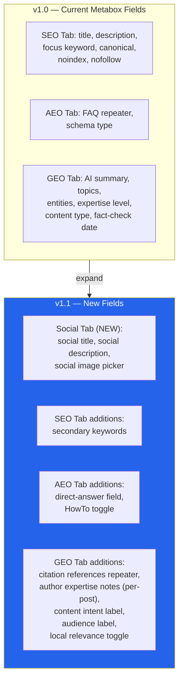

#### New Post Meta Fields

| Meta Key | Tab | Type | Description |
|----------|-----|------|-------------|
| `_search_intel_social_title` | Social | text | Override title for OG/Twitter (falls back to SEO title) |
| `_search_intel_social_description` | Social | textarea | Override description for social sharing |
| `_search_intel_social_image` | Social | image picker | Custom OG image with media library integration |
| `_search_intel_secondary_keywords` | SEO | text (CSV) | Secondary keyword targets for LSI analysis |
| `_search_intel_direct_answer` | AEO | textarea | "What is this post answering?" — concise direct answer |
| `_search_intel_citations` | GEO | repeater | `[{source, url, date, quote}]` — structured source references |
| `_search_intel_author_notes` | GEO | textarea | Per-post author expertise/experience notes |
| `_search_intel_content_intent` | GEO | select | informational, commercial, navigational, educational, transactional |
| `_search_intel_audience` | GEO | select | beginner, intermediate, advanced, professional, general |
| `_search_intel_local_relevance` | GEO | checkbox + text | Toggle + location/region string |

### Title Template Engine

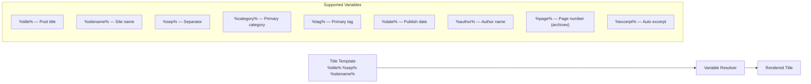

#### Title Template Settings

| Context | Default Template | Configurable |
|---------|-----------------|--------------|
| Single posts | `%title% %sep% %sitename%` | Yes |
| Pages | `%title% %sep% %sitename%` | Yes |
| Categories | `%category% Archives %sep% %sitename%` | Yes |
| Tags | `%tag% %sep% %sitename%` | Yes |
| Author archives | `%author% %sep% %sitename%` | Yes |
| Search results | `Search: %search_query% %sep% %sitename%` | Yes |
| 404 | `Page Not Found %sep% %sitename%` | Yes |
| Homepage | `%sitename% %sep% %tagline%` | Yes |

### Analysis-on-Save

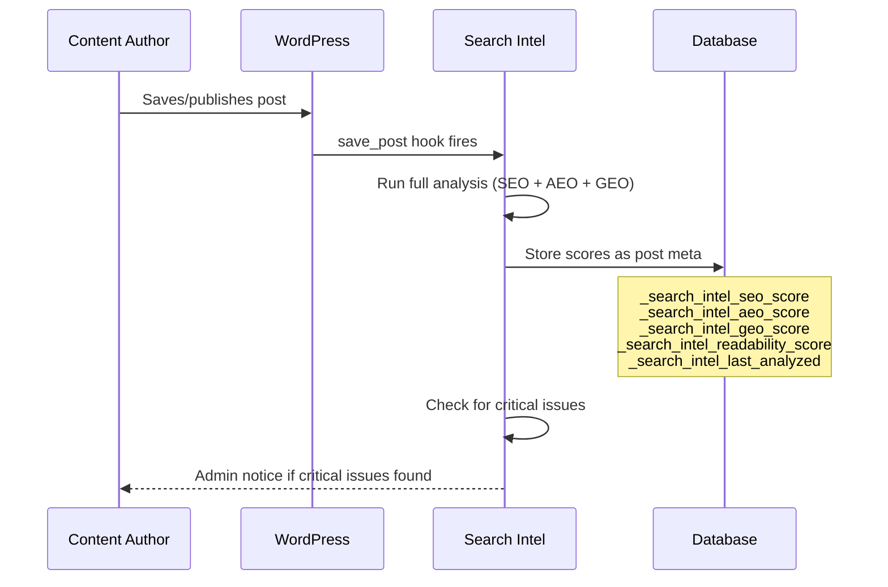

#### New Analysis Checks (v1.1)

| Check | Module | Points | Description |
|-------|--------|--------|-------------|
| H1 presence | SEO | 5 | Verify exactly one H1 exists (or post title serves as H1) |
| H1/H2 hierarchy | SEO | 5 | No heading level skips (H2 before H3, etc.) |
| Internal link suggestions | SEO | — | Suggest related posts to link to (informational, not scored) |
| External citation count | GEO | 10 | At least 1 external authority link |
| Answer block opportunity | AEO | 10 | Detect if content could use a direct-answer block |
| Entity clarity | GEO | 10 | Key entities defined in entities repeater |
| AI summary present | GEO | 15 | Has a custom AI summary been written? |
| Schema completeness | All | 10 | All applicable schema fields filled |
| Secondary keyword usage | SEO | 5 | Secondary keywords appear in content |
| Social metadata filled | SEO | 5 | Social title + description + image set |

### Expanded Global Settings

| Setting | Section | Type | Description |
|---------|---------|------|-------------|
| `default_og_image` | SEO | image URL | Fallback OG image when no featured image exists |
| `title_templates` | SEO | array of templates | Per-context title templates with variable support |
| `description_fallback` | SEO | select | Fallback behavior: excerpt → content trim → empty |
| `description_max_length` | SEO | number | Auto-trim length (default 160) |
| `global_robots_default` | SEO | select | Default robots for new posts (index,follow / noindex / etc.) |
| `taxonomy_sitemaps` | Sitemap | checkboxes | Which taxonomies to include (category, post_tag, custom) |
| `cpt_sitemaps` | Sitemap | checkboxes | Which custom post types to include |
| `ai_summary_default_length` | GEO | number | Target word count for AI summaries |
| `default_content_intent` | GEO | select | Default intent when not set per-post |
| `default_audience` | GEO | select | Default audience when not set per-post |
| `rest_api_enabled` | GEO | toggle | Enable/disable the REST API GEO endpoint |
| `ping_on_publish` | Sitemap | toggle | Enable/disable search engine pinging |

### Sitemap Caching

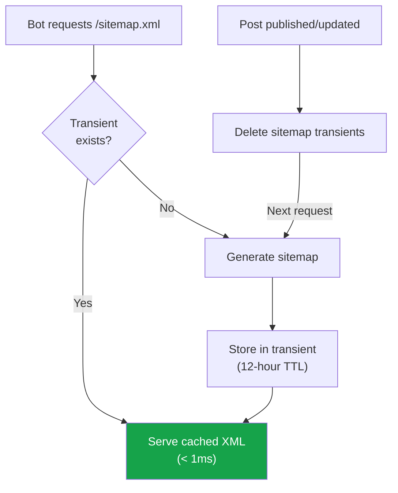

### AEO Additions

| Feature | Implementation |
|---------|----------------|
| **Direct-answer field** | New meta field rendered as a `<meta name="answer" content="...">` tag and included in Article schema as `description` |
| **Q&A style detection** | Regex scan for question-then-answer patterns beyond just headings; detect `<strong>Q:</strong>` and similar inline patterns |
| **Answer snippet score** | New sub-score in AEO analysis: rates how well content is formatted for featured snippet selection (40-word answer blocks, definition patterns, list formatting) |
| **Summary block generation** | Auto-generate a lead summary from first 2-3 sentences if no manual excerpt exists; store as `_search_intel_auto_excerpt` |

### GEO Additions

| Feature | Implementation |
|---------|----------------|
| **Citations in JSON-LD** | Render `citation` property in Article schema with `@type: CreativeWork` for each source reference |
| **Content intent meta** | `<meta name="content-intent" content="informational">` + included in JSON-LD as `educationalUse` or custom property |
| **Audience meta** | `<meta name="audience" content="professional">` + `schema.org/audience` property |
| **Local relevance** | When enabled, add `contentLocation` to schema with `@type: Place` |

---

## Phase 2 — Hardening & Testing (v1.2)

**Target: 2026 Q3 | Focus: Security audit, automated tests, CI/CD, performance, compatibility QA**

### Security Hardening

| Task | Priority | Description |
|------|----------|-------------|
| Input sanitization audit | Critical | Review all `$_POST`, `$_GET`, `$_REQUEST` — ensure 100% sanitization |
| Output escaping audit | Critical | Verify every `echo`/`printf` uses `esc_html`, `esc_attr`, `esc_url` |
| Nonce coverage check | Critical | Every form submission and AJAX handler must verify nonces |
| SQL injection review | Critical | All `$wpdb` calls use prepared statements exclusively |
| CSRF protection | High | All state-changing operations check nonces + capabilities |
| File upload validation | High | Social image picker: validate MIME types, file sizes, dimensions |
| Rate limiting on AJAX | Medium | Throttle content analysis AJAX to prevent abuse |
| Security headers | Medium | `X-Content-Type-Options: nosniff` on sitemap, llms.txt, REST endpoints |
| Automated SAST scanning | Medium | Add PHPStan + Psalm to CI for static analysis |

### Automated Test Suite

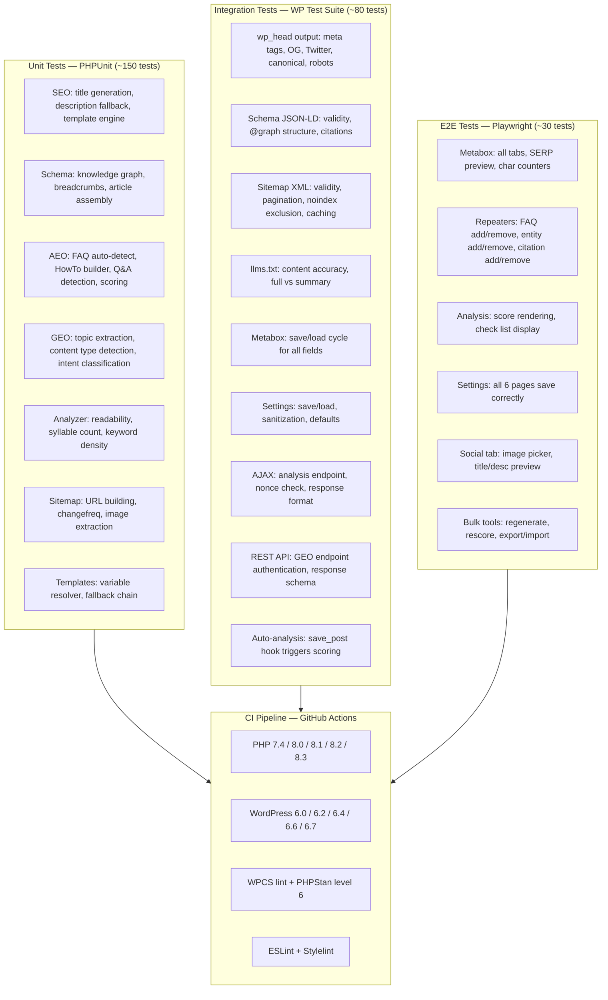

### Performance Targets

| Metric | Target | Method |
|--------|--------|--------|
| `wp_head` total added time | < 5ms | Profile with Query Monitor |
| Schema JSON generation | < 2ms | Benchmark `render_schema()` |
| Sitemap (1000 posts, cached) | < 5ms | Transient cache hit |
| Sitemap (1000 posts, cold) | < 500ms | Generate + cache |
| Admin page load impact | < 50ms | Lazy-load metabox JS/CSS |
| Frontend JS/CSS | 0 KB | No public-facing assets |
| Database queries per page | < 6 added | Batch `get_post_meta()` calls |
| Analysis-on-save overhead | < 200ms | Async via `wp_after_insert_post` |

### Compatibility QA Matrix

| Environment | Test Method | Acceptance Criteria |
|-------------|------------|---------------------|
| Classic themes (TwentyTwelve–TwentyTwentyOne) | Manual + E2E | All meta tags render in `wp_head` |
| Block themes (TwentyTwentyTwo+) | Manual + E2E | All meta tags render, blocks available |
| Hybrid themes (Astra, GeneratePress, Kadence) | Manual | No conflicts with theme SEO features |
| Page builders (Elementor, Beaver Builder, Divi) | Manual | `wp_head` fires, metabox accessible |
| Theme frameworks (Genesis, developer themes) | Manual | Test `genesis_meta` and similar hooks |
| Classic Editor plugin | E2E | TinyMCE content extraction works |
| Block Editor (Gutenberg) | E2E | `wp.data` content extraction works |
| WooCommerce (basic) | Manual | No fatal errors, product pages work |
| WPML / Polylang | Manual | No conflicts, translatable strings |
| Custom themes without `wp_head` | Admin notice | Warning displayed if hook missing |

---

## Phase 3 — Bulk Tools & REST API (v1.3)

**Target: 2026 Q3-Q4 | Focus: Bulk operations, REST endpoints, WP-CLI, import/export**

### Bulk Tools Admin Page

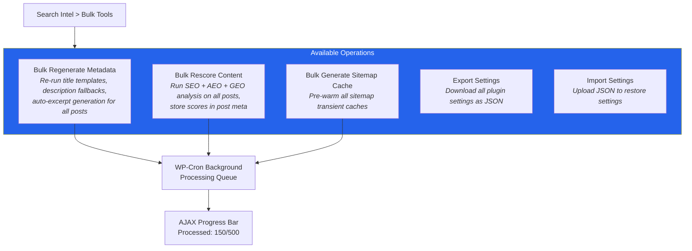

#### Bulk Processing Architecture

| Operation | Method | Batch Size | Estimated Speed |
|-----------|--------|------------|-----------------|
| Regenerate metadata | `WP_Background_Process` | 50 posts/batch | ~500 posts/min |
| Rescore content | `WP_Background_Process` | 20 posts/batch | ~200 posts/min |
| Sitemap cache | Direct transient writes | All at once | < 5 seconds |
| Export settings | JSON download | Single operation | Instant |
| Import settings | JSON upload + validate | Single operation | Instant |

### REST API for GEO Metadata

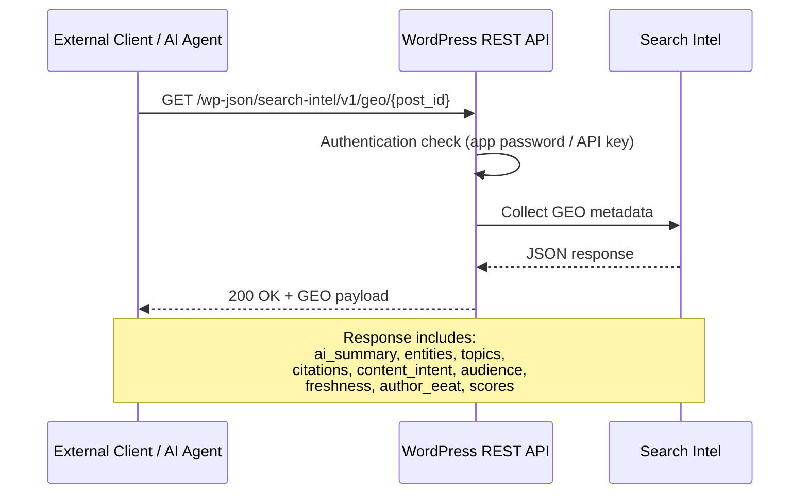

#### REST API Endpoints

| Endpoint | Method | Auth | Description |
|----------|--------|------|-------------|
| `/search-intel/v1/geo/{id}` | GET | Optional | Full GEO metadata for a post |
| `/search-intel/v1/scores/{id}` | GET | Optional | SEO + AEO + GEO scores |
| `/search-intel/v1/meta/{id}` | GET/PUT | Required | Read/write SEO meta fields |
| `/search-intel/v1/analyze/{id}` | POST | Required | Trigger analysis and return results |
| `/search-intel/v1/bulk/rescore` | POST | Required | Queue bulk rescore job |
| `/search-intel/v1/settings` | GET/PUT | Admin | Read/write plugin settings |
| `/search-intel/v1/sitemap/invalidate` | POST | Admin | Clear sitemap cache |

### WP-CLI Commands

| Command | Description |
|---------|-------------|
| `wp search-intel analyze <post_id>` | Run full analysis on a single post |
| `wp search-intel rescore --all` | Rescore all published posts |
| `wp search-intel regenerate --all` | Regenerate metadata for all posts |
| `wp search-intel sitemap cache` | Pre-warm sitemap caches |
| `wp search-intel export > settings.json` | Export settings to JSON |
| `wp search-intel import < settings.json` | Import settings from JSON |
| `wp search-intel scores --format=table` | Show scores for all posts |
| `wp search-intel migrate --from=yoast` | Migrate data from another SEO plugin |

### Settings Import/Export Schema

```mermaid
flowchart LR
    subgraph Export["Export Payload"]
        E1["search_intel_settings"]
        E2["search_intel_social_profiles"]
        E3["search_intel_ai_permissions"]
        E4["Plugin version"]
        E5["Export timestamp"]
    end

    Export -->|"JSON download"| FILE["settings.json"]
    FILE -->|"JSON upload"| Import

    subgraph Import["Import Process"]
        I1["Validate JSON structure"]
        I2["Check version compatibility"]
        I3["Sanitize all values"]
        I4["Merge or overwrite (user choice)"]
        I5["Flush rewrite rules"]
    end
```

---

## Phase 4 — FSE & Block Editor Native (v1.4)

**Target: 2026 Q4 | Focus: Gutenberg blocks, sidebar panel, FSE template integration**

### Block Editor Migration Strategy

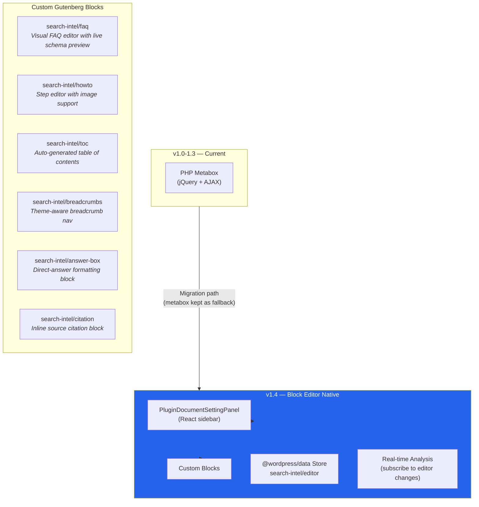

### FSE Theme Compatibility

| Feature | Classic Themes | FSE Themes | Implementation |
|---------|---------------|------------|----------------|
| Meta tags | `wp_head` hook | `wp_head` hook | Already works |
| Schema JSON-LD | `wp_head` hook | `wp_head` hook | Already works |
| Breadcrumbs | Shortcode / `si_breadcrumbs()` | Block + template part | Add block v1.4 |
| FAQ display | Shortcode | Block | Add block v1.4 |
| HowTo display | Shortcode | Block | Add block v1.4 |
| Answer box | Shortcode | Block | New in v1.4 |
| SERP preview | Metabox | Sidebar panel | Migrate v1.4 |
| Score display | Metabox tab | Sidebar panel | Migrate v1.4 |
| Settings pages | admin.php | admin.php | Universal |

### Backward Compatibility

| Scenario | Behavior |
|----------|----------|
| Classic Editor active | PHP metabox (unchanged from v1.0) |
| Block Editor, sidebar loaded | React sidebar panel (primary) + metabox (hidden) |
| FSE theme, no blocks used | `wp_head` output only (unchanged) |
| FSE theme, blocks inserted | Block renders + `wp_head` output (deduplicated) |
| Shortcodes in block content | Rendered via `do_shortcode` + deprecation notice |
| `theme.json` present | Read color palette for admin score ring UI |

---

## Phase 5 — Privacy & Compliance (v1.5)

**Target: 2027 Q1 | Focus: GDPR, CCPA, privacy-by-design**

### Privacy Architecture

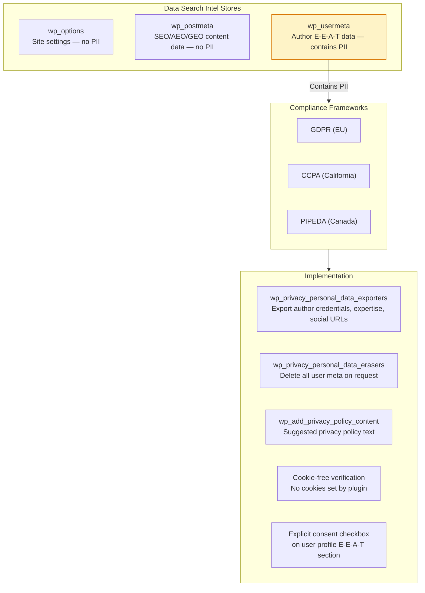

### Privacy Checklist

| Requirement | Status | Target |
|-------------|--------|--------|
| No frontend cookies | Done v1.0 | Verified |
| No external API calls (default) | Done v1.0 | Only optional pinging |
| No tracking scripts | Done v1.0 | Zero frontend JS/CSS |
| No third-party data sharing | Done v1.0 | All data local |
| Personal data export (Art. 15) | Planned | v1.5 — register exporter for user meta |
| Personal data erasure (Art. 17) | Planned | v1.5 — register eraser for user meta |
| Privacy policy text | Planned | v1.5 — `wp_add_privacy_policy_content()` |
| Consent for E-E-A-T data | Planned | v1.5 — checkbox on user profile |
| Data minimization audit | Planned | v1.5 — review all stored fields |
| Ping opt-in disclosure | Planned | v1.5 — clear setting description |

### Data Inventory

| Data Type | Storage | PII? | Basis | Retention |
|-----------|---------|------|-------|-----------|
| Site settings | `wp_options` | No | Legitimate interest | Until uninstall |
| Social profile URLs | `wp_options` | Possibly | Legitimate interest | Until uninstall |
| Post SEO meta | `wp_postmeta` | No | Legitimate interest | Until post deletion |
| Post AEO data | `wp_postmeta` | No | Legitimate interest | Until post deletion |
| Post GEO data | `wp_postmeta` | No | Legitimate interest | Until post deletion |
| Post citations | `wp_postmeta` | No | Legitimate interest | Until post deletion |
| Post scores | `wp_postmeta` | No | Legitimate interest | Until post deletion |
| Author credentials | `wp_usermeta` | Yes | Consent | Until erasure request |
| Author expertise | `wp_usermeta` | Yes | Consent | Until erasure request |
| Author social profiles | `wp_usermeta` | Yes | Consent | Until erasure request |

---

## Phase 6 — Advanced SEO (v2.0)

**Target: 2027 Q1-Q2 | Focus: Redirects, IndexNow, WooCommerce, local SEO, robots.txt**

### Feature Set

| Feature | Description | Standard |
|---------|-------------|----------|
| Redirect manager | 301/302/307 rules with regex, import from CSV, change detection | HTTP status |
| IndexNow integration | Instant indexing ping to Bing/Yandex/Naver on publish | IndexNow protocol |
| WooCommerce Product schema | Product, Offer, AggregateRating, Review with auto-detection | schema.org/Product |
| Local Business schema | LocalBusiness with address, hours, geo coordinates, service area | schema.org/LocalBusiness |
| Robots.txt visual editor | Edit robots.txt from admin with syntax validation | REP |
| Broken link checker | Background scan for 404 internal/external links | HTTP HEAD |
| Internal linking suggestions | AI-powered related content suggestions on save | Content analysis |

### WooCommerce Integration

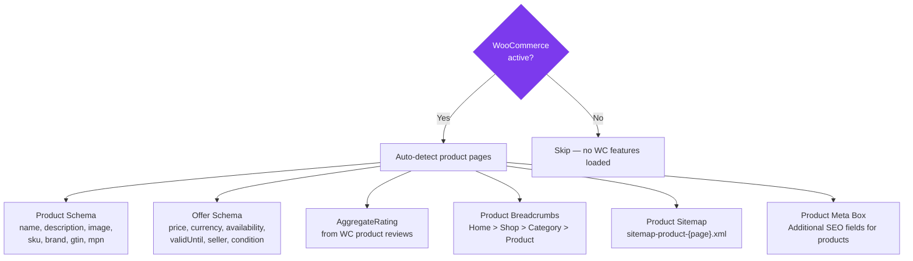

### Redirect Manager

```mermaid
flowchart LR
    subgraph Sources["Redirect Sources"]
        S1["Manual rule entry"]
        S2["404 log auto-detection"]
        S3["CSV import"]
        S4["Slug change detection"]
    end

    subgraph Engine["Redirect Engine"]
        R1["Pattern matching<br/>(exact, prefix, regex)"]
        R2["Status codes<br/>(301, 302, 307, 410)"]
        R3["Condition checks<br/>(user agent, referrer)"]
    end

    subgraph Output["Execution"]
        O1["wp_redirect at template_redirect"]
        O2["Hit counter + last-hit date"]
        O3["Admin table with search/filter"]
    end

    Sources --> Engine --> Output
```

---

## Phase 7 — Advanced AEO (v2.1)

**Target: 2027 Q2-Q3 | Focus: Additional schema types, AI-assisted content**

### Additional Schema Types

| Schema Type | Use Case | Detection | Input |
|-------------|----------|-----------|-------|
| VideoObject | YouTube/Vimeo embeds | Auto-detect `<iframe>` | Auto + manual override |
| Recipe | Food/cooking content | Manual toggle | Block or metabox |
| Event | Conferences, webinars | Manual entry | Date, location, price |
| Review / Rating | Product/service reviews | Manual toggle | Star rating, pros/cons |
| Course | Educational content | Manual entry | Provider, duration, price |
| SoftwareApplication | App/tool pages | Manual entry | OS, price, rating |
| JobPosting | Job listings | Manual entry | Salary, location, type |

### AI-Assisted FAQ Generation

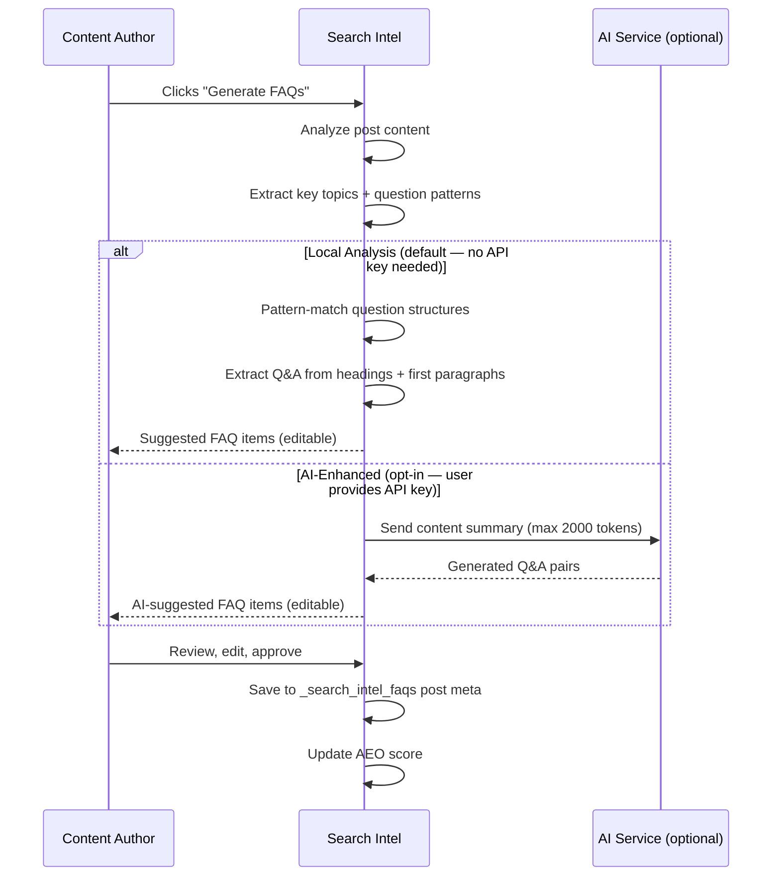

### Q&A Detection Engine

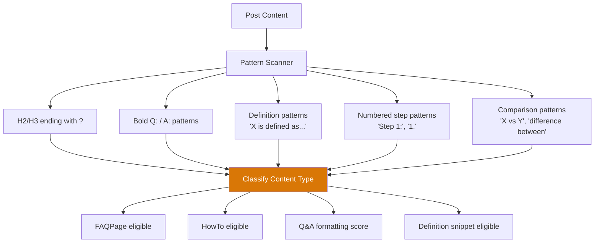

---

## Phase 8 — Advanced GEO (v2.5)

**Target: 2027 Q3-Q4 | Focus: AI visibility analytics, citation optimization, topical authority**

### AI Visibility Dashboard

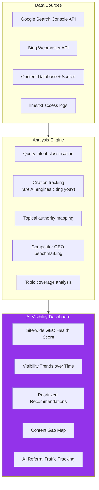

### Citation Graph Builder

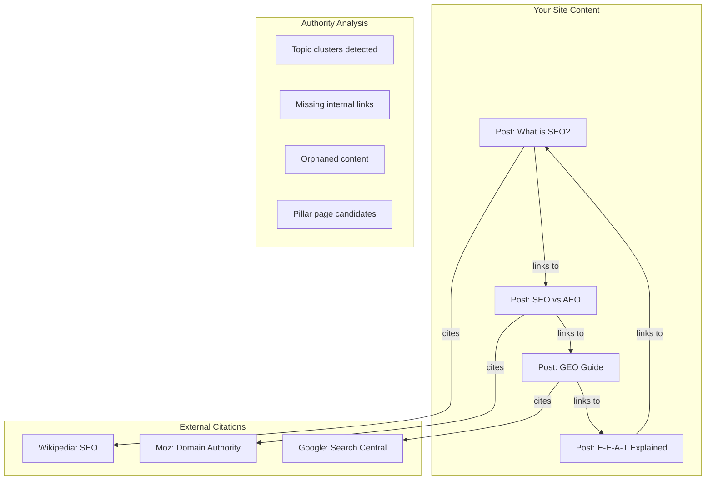

### Topical Authority Map

| Feature | Description |
|---------|-------------|
| Topic cluster detection | Auto-group posts by shared entities, categories, and semantic similarity |
| Pillar page identification | Suggest comprehensive hub pages per cluster |
| Content gap analysis | Identify missing subtopics vs competitor coverage |
| Internal linking score | Rate interconnectedness within and across clusters |
| Authority score per topic | Estimate topical depth based on content volume, freshness, and E-E-A-T signals |
| Multimodal optimization | Analyze image alt text, video transcripts, and structured data completeness for AI |

---

## Phase 9 — Enterprise & Scale (v3.0)

**Target: 2027 Q4+ | Focus: Multisite, migration, RBAC, white-label, multi-language**

### Enterprise Features

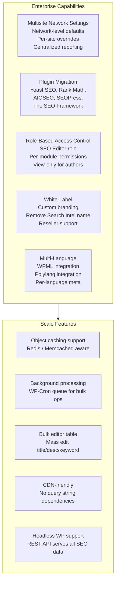

### Migration Tool

| Source Plugin | Data Migrated |
|---------------|---------------|
| Yoast SEO | Titles, descriptions, focus keywords, robots, canonical, OG, schema, redirects, breadcrumb settings |
| Rank Math | Titles, descriptions, focus keywords, robots, canonical, schema, redirects, 404 monitor data |
| All in One SEO | Titles, descriptions, robots, OG, Twitter, canonical, local SEO |
| SEOPress | Titles, descriptions, robots, OG, Twitter, canonical, redirects, schemas |
| The SEO Framework | Titles, descriptions, robots, canonical |

### Multi-Language Support

| Feature | WPML | Polylang |
|---------|------|----------|
| Per-language SEO title | Translatable string | Translatable string |
| Per-language meta description | Translatable string | Translatable string |
| Per-language OG image | Per translation | Per translation |
| hreflang tags | Auto-generated | Auto-generated |
| Sitemap per language | Separate or combined | Separate or combined |
| llms.txt per language | Language parameter | Language parameter |

---

## Long-Term Vision

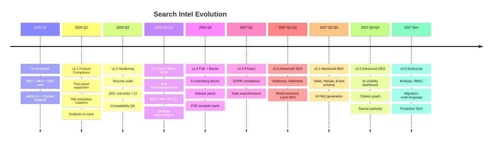

---

## Compatibility Matrix

### WordPress Version Support

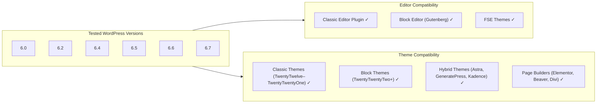

### PHP & Server Matrix

| Component | Minimum | Recommended |
|-----------|---------|-------------|
| WordPress | 6.0 | 6.5+ |
| PHP | 7.4 | 8.1+ |
| MySQL | 5.7 | 8.0+ |
| MariaDB | 10.3 | 10.6+ |
| Web Server | Apache 2.4 / Nginx 1.18 | Latest stable |
| Memory | 64 MB | 128 MB+ |
| HTTPS | Recommended | Required for full schema |

### Plugin Compatibility

| Plugin | Status | Notes |
|--------|--------|-------|
| Classic Editor | Full support | PHP metabox, TinyMCE content extraction |
| WooCommerce | Basic v1.0, full v2.0 | Product schema auto-detect in v2.0 |
| WPML | Tested v1.2, integrated v3.0 | hreflang, per-language meta in v3.0 |
| Polylang | Tested v1.2, integrated v3.0 | Same as WPML |
| Elementor | Compatible | `wp_head` fires normally |
| Beaver Builder | Compatible | `wp_head` fires normally |
| Divi | Compatible | `wp_head` fires normally |
| ACF | Compatible | No conflicts |
| WP Rocket | Compatible | Cache-friendly, no query strings |

---

## Security Roadmap

### Security Milestones

```mermaid
flowchart TD
    subgraph V10["v1.0 — Baseline"]
        S1["Input sanitization"]
        S2["Output escaping"]
        S3["Nonce verification"]
        S4["Capability checks"]
        S5["ABSPATH guards"]
        S6["No frontend assets"]
    end

    subgraph V12["v1.2 — Hardened"]
        S7["Full security audit"]
        S8["Prepared statements review"]
        S9["CSRF on every form"]
        S10["Rate limiting on AJAX"]
        S11["Security headers on endpoints"]
        S12["Automated SAST (PHPStan/Psalm)"]
    end

    subgraph V20["v2.0 — Extended"]
        S13["Content Security Policy headers"]
        S14["Subresource Integrity for assets"]
        S15["Redirect loop detection"]
        S16["Audit logging for settings changes"]
    end

    subgraph V30["v3.0 — Enterprise"]
        S17["Role-based access control"]
        S18["REST API auth (app passwords)"]
        S19["Encryption for sensitive settings"]
        S20["Penetration testing report"]
    end

    V10 --> V12 --> V20 --> V30
```

### Security Principles

| Principle | Implementation |
|-----------|----------------|
| **Defense in depth** | Sanitize input AND escape output — never rely on one alone |
| **Least privilege** | Each action checks minimum required capability |
| **Secure defaults** | All features safe out-of-the-box; advanced features opt-in |
| **No trust of client data** | All POST/GET/REQUEST data treated as hostile |
| **Minimal attack surface** | Zero frontend JS/CSS; no external API keys required by default |
| **Fail closed** | Security check failure = action denied silently |
| **Audit trail** | Settings changes logged (v3.0) |
| **Dependency hygiene** | No third-party PHP libraries; minimal JS dependencies |

---

## Privacy Roadmap

### Privacy-by-Design Principles

| Principle | Status | Target |
|-----------|--------|--------|
| Data minimization | Only necessary metadata stored | Audit v1.5 |
| Purpose limitation | Each field has clear SEO/AEO/GEO purpose | Document v1.5 |
| Consent | User meta requires profile edit action | Explicit checkbox v1.5 |
| Right to access | Not yet implemented | GDPR exporter v1.5 |
| Right to erasure | Uninstall cleans all data | GDPR eraser v1.5 |
| Data portability | Not yet implemented | JSON export v1.3 |
| Privacy by default | No PII collected on frontend | Verified v1.0 |
| Cookie-free | No cookies set | Verified v1.0 |
| No external requests by default | Only optional pinging | Verified v1.0 |
| Transparent data processing | Not yet documented | Privacy policy text v1.5 |

---

## Testing Strategy

### Test Pyramid

```mermaid
flowchart TD
    subgraph Pyramid["Test Pyramid"]
        E2E_L["E2E Tests — Playwright<br/>~30 tests<br/>UI flows, metabox, settings, bulk tools"]
        INT_L["Integration Tests — WP Test Suite<br/>~80 tests<br/>Hooks, DB, AJAX, REST API, save/load"]
        UNIT_L["Unit Tests — PHPUnit<br/>~150 tests<br/>Pure logic, scoring, templates, detection"]
    end

    E2E_L -->|"Headless Chrome"| BROWSER["Browser"]
    INT_L -->|"WordPress test framework"| WPTEST["WP + MySQL"]
    UNIT_L -->|"No WP dependencies"| PHPUNIT["PHPUnit 9/10"]

    style UNIT_L fill:#16a34a,color:#fff
    style INT_L fill:#d97706,color:#fff
    style E2E_L fill:#dc2626,color:#fff
```

### Test Coverage by Module

| Module | Unit Tests | Integration Tests | E2E Tests |
|--------|-----------|-------------------|-----------|
| SEO Manager | Title templates, description fallback, separator, social meta | wp_head output, OG/Twitter/canonical rendering | SERP preview, char counters |
| Schema Manager | KG, breadcrumbs, article, citation schema assembly | JSON-LD validity, @graph structure | N/A |
| AEO Manager | FAQ auto-detect, HowTo builder, Q&A detection, snippet scoring | FAQ/HowTo JSON-LD, Speakable | FAQ repeater UI |
| GEO Manager | Topic extraction, intent classification, audience detect, scoring | llms.txt, AI meta, entity markup, REST endpoint | Entity/citation repeater UI |
| Content Analyzer | Readability, syllables, keyword density, all check functions | AJAX endpoint, auto-analysis on save | Run Analysis button, scores |
| Sitemap | URL build, changefreq, image extraction, cache logic | XML validity, pagination, transient caching | N/A |
| Admin | Sanitization, meta save/load, settings validation | Menu registration, metabox rendering, user fields | All tabs, settings pages |
| Title Engine | Variable resolution, fallback chain, context detection | `pre_get_document_title` integration | N/A |
| Bulk Tools | Queue processing logic, batch sizing | Background process, progress tracking | Regenerate/rescore UI |
| REST API | Response schema validation | Auth, endpoint routing, CORS | N/A |

### CI/CD Pipeline

```mermaid
flowchart LR
    PUSH["Git Push"] --> LINT["Lint"]
    LINT --> UNIT["Unit Tests"]
    UNIT --> INTEGRATION["Integration Tests"]
    INTEGRATION --> E2E["E2E Tests"]
    E2E --> BUILD["Build"]
    BUILD --> RELEASE["Release"]

    subgraph Lint
        PHPCS["PHP_CodeSniffer<br/>WordPress-Core"]
        PHPSTAN["PHPStan Level 6"]
        PSALM["Psalm Level 4"]
        ESLINT["ESLint"]
        STYLELINT["Stylelint"]
    end

    subgraph Matrix["Test Matrix"]
        PHP74["PHP 7.4 + WP 6.0"]
        PHP81["PHP 8.1 + WP 6.5"]
        PHP83["PHP 8.3 + WP 6.7"]
    end

    LINT --> Lint
    UNIT --> Matrix
    INTEGRATION --> Matrix
```

### Quality Gates

| Gate | Threshold | Blocks Release? |
|------|-----------|-----------------|
| WPCS lint | 0 errors | Yes |
| PHPStan level 6 | 0 errors | Yes |
| Unit test pass rate | 100% | Yes |
| Integration test pass rate | 100% | Yes |
| E2E test pass rate | 95%+ | Yes |
| Code coverage (unit) | > 80% | No (advisory) |
| Code coverage (integration) | > 60% | No (advisory) |
| Performance regression | < 10% degradation | Yes |

---

_Last updated: March 2026_
_This roadmap is a living document and will be updated as priorities evolve._
